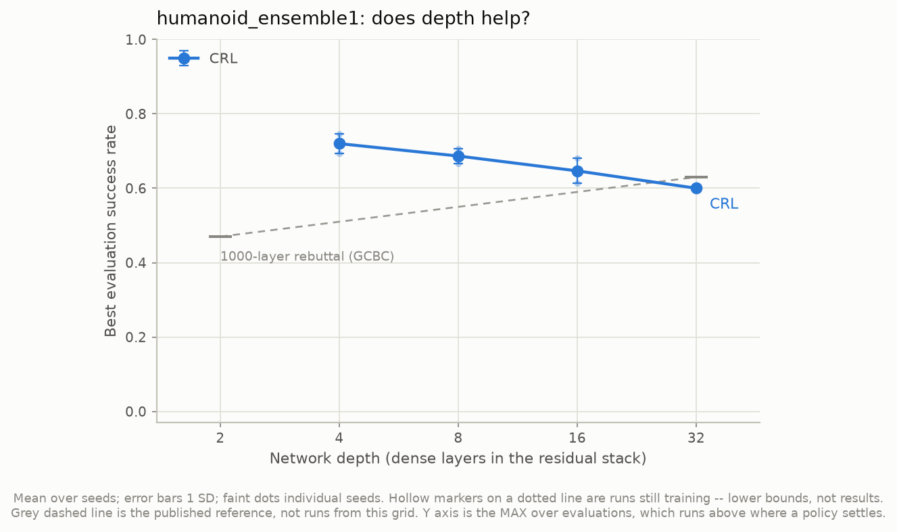
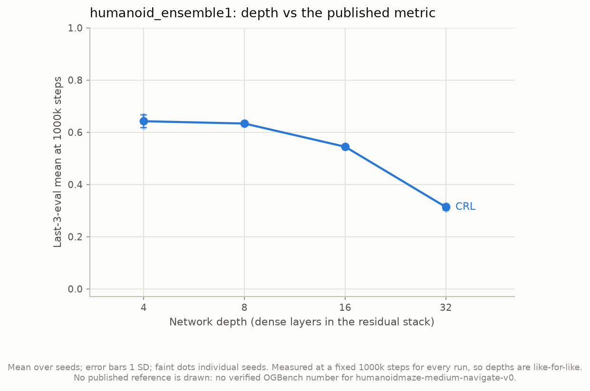
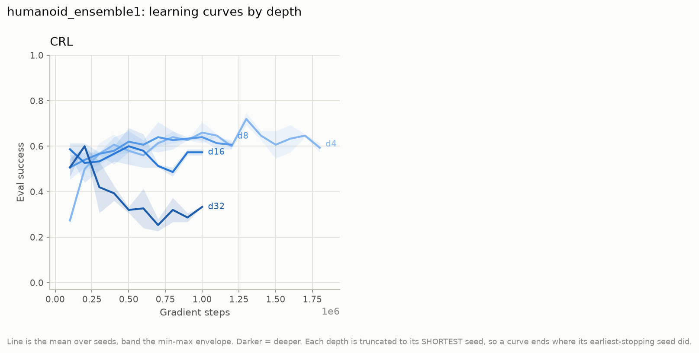
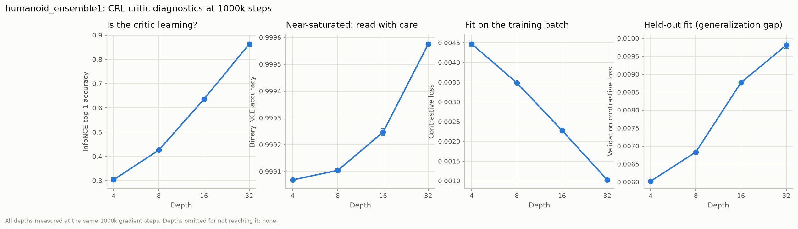
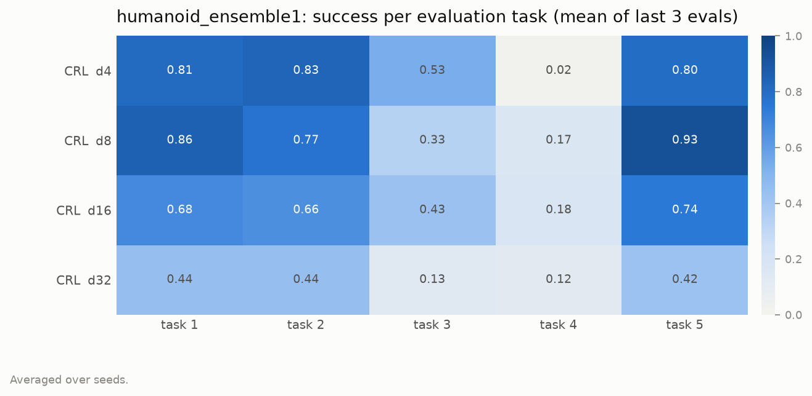
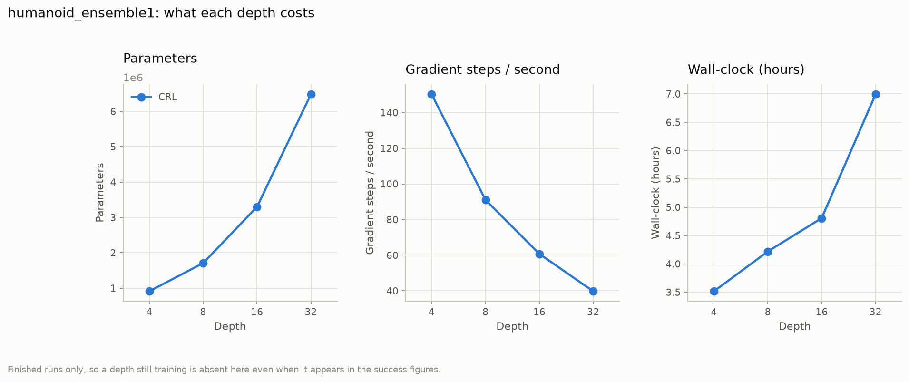

# humanoid_ensemble1 — does the depth result survive a change of environment?

Compiled 2026-11-06. **8 of 8 runs finished** (CRL, depths 4/8/16/32, 2 seeds each) on
`humanoidmaze-medium-navigate-v0`.

Figures are in this folder, PNG + CSV. Every number below is read from those CSVs; the
tables are not typed from terminal output.

> **Headline: the depth result reverses here.** On `antmaze-medium-stitch`, CRL success
> rose monotonically with depth (42.7 → 87.1 best-eval, 4 → 32 layers). On
> `humanoidmaze-medium-navigate` it *falls* monotonically: **72.0 → 68.7 → 64.7 → 60.0**
> best-eval, and **64.2 → 63.3 → 54.4 → 31.3** on the settled metric. The decline is
> larger than the seed spread at every depth.
>
> **And the critic is not what fails.** The critic gets monotonically *better* at its own
> objective with depth, in both environments and by roughly the same margin — categorical
> accuracy 30.4 → 86.3 here vs 36.9 → 80.9 on antmaze. Depth buys the same amount of
> critic, and the control it buys flips sign.
>
> **Read §4 before quoting any of this.** This grid differs from `phase1_repro` in
> **three** ways, not one, so it does not isolate the environment.

---

## 1. What is different from `phase1_repro`

`experiments/humanoid_ensemble1.yaml` describes itself as changing the dataset and
`critic_ensemble`. Read from the two runs' own `config.json`, there are three
differences:

| | `phase1_repro` | `humanoid_ensemble1` |
|---|---|---|
| dataset | `antmaze-medium-stitch-v0` | `humanoidmaze-medium-navigate-v0` |
| `critic_ensemble` | 2 | **1** |
| `discount` | 0.99 | **0.995** |
| seeds | 3 | 2 |
| observation / action dim | 29 / 8 | 69 / 21 |
| trajectory length | 201 rows | 2001 rows |

The `discount` difference is not in the YAML: `use_published_flags` picks up OGBench's
published CRL command for this dataset, which sets 0.995. That doubles the geometric
goal-sampling horizon. It is the right setting to run — it is what the published number
was measured with — but it is a third thing that moved.

So "depth helps on antmaze and hurts on humanoidmaze" is not what these two grids
support. What they support is: **the configuration that scales on antmaze does not scale
here.** §4 lists what would separate the causes.

Two more differences worth holding, because they cut the other way:

- `-navigate` is not `-stitch`. Its trajectories are 2001 rows, so a single trajectory
  can cover a whole route and far less stitching is required. Stitching is exactly what
  CRL's depth bought on antmaze (§7 of
  [`../phase1_repro/README.md`](../phase1_repro/README.md)), so there may simply be less
  of that work to do here.
- The maze is the *same* 8×8 grid with the same five (start, goal) cell pairs. The body
  and the data changed; the geometry did not.

---

## 2. Success vs depth

`fig1_success_vs_depth.csv`, max over evaluations, 15 episodes/task × 5 tasks:

| depth | n | mean | SD | seeds |
|---|---|---|---|---|
| 4 | 2 | **0.720** | 0.027 | 0.693, 0.747 |
| 8 | 2 | 0.687 | 0.020 | 0.707, 0.667 |
| 16 | 2 | 0.647 | 0.033 | 0.613, 0.680 |
| 32 | 2 | 0.600 | 0.000 | 0.600, 0.600 |

`fig1b_last3_vs_depth.csv`, mean of the final three evaluations pinned to a common
1,000,000 steps — the metric OGBench's table uses, and the one to quote:

| depth | n | mean | SD | seeds |
|---|---|---|---|---|
| 4 | 2 | **0.642** | 0.024 | 0.618, 0.667 |
| 8 | 2 | 0.633 | 0.007 | 0.627, 0.640 |
| 16 | 2 | 0.544 | 0.007 | 0.538, 0.551 |
| 32 | 2 | 0.313 | 0.011 | 0.302, 0.324 |

The two metrics disagree about *how* bad depth 32 is, and the disagreement is the
finding. Best-eval says 60.0%; settled says 31.3%. §3 is why.

---

## 3. Deeper networks peak earlier and then come apart

From each run's `summary.json`, the step at which the best evaluation occurred:

| depth | seed 0 | seed 1 | best eval | settled (last3) | gap |
|---|---|---|---|---|---|
| 4 | 1,300,000 | 1,300,000 | 0.720 | 0.642 | −0.08 |
| 8 | 700,000 | 500,000 | 0.687 | 0.633 | −0.05 |
| 16 | 100,000 | 500,000 | 0.647 | 0.544 | −0.10 |
| 32 | 200,000 | 200,000 | 0.600 | 0.313 | **−0.29** |

Depth 32 reaches its best score at 200k steps — one fifth of the way in — and then loses
half of it. Depth 4 peaks at 1.3M and holds. **The peak moves earlier as depth
increases, and the collapse after it gets worse.** This is why the two metrics disagree:
`best_success` is a max over evaluations and so reports the pre-collapse peak, while
last3 reports where the run actually ended up.

Every run stopped on `plateau`, not on the step cap, and `plateau_min_steps` is
1,000,000 — so each deep run was *required* to keep training for ~800k steps past its
own peak. That is a configuration choice interacting with the finding, not a property of
depth: a depth-32 run early-stopped at its peak would have scored 0.600, not 0.313.

### 3.1 It looks like overfitting, and the critic metrics agree

`fig3_critic_diagnostics.csv` at 1,000,000 steps, with antmaze beside it for scale:

| metric | d4 | d8 | d16 | d32 | direction |
|---|---|---|---|---|---|
| categorical accuracy (humanoid) | 0.304 | 0.426 | 0.637 | **0.863** | ↑ with depth |
| categorical accuracy (antmaze) | 0.369 | 0.467 | 0.607 | 0.809 | ↑ with depth |
| train contrastive loss (humanoid) | 0.00447 | 0.00349 | 0.00228 | **0.00103** | ↓ (better fit) |
| **val** contrastive loss (humanoid) | 0.00602 | 0.00683 | 0.00877 | **0.00981** | ↑ (worse) |
| **val** contrastive loss (antmaze) | 0.00530 | 0.00549 | 0.00642 | 0.00856 | ↑ (worse) |

Train and validation contrastive loss move in *opposite* directions as depth grows, in
both environments: the deeper critic fits the training objective better and generalises
worse. The humanoid runs make 512–1024 passes over 2M transitions, so there is ample
opportunity.

But note what this does **not** explain. The train/val decoupling is present on antmaze
too, at a similar magnitude, and there depth still helped. Overfitting of the contrastive
objective is therefore not sufficient on its own to produce the reversal — something
about how this critic converts into actions has to differ. That is what
[`../interp01/`](../interp01/) is built to measure, and it has not yet been run on this
grid (§5).

---

## 4. What would actually separate the causes

The reversal has at least four candidate explanations, and this grid cannot distinguish
them:

1. **The body.** 69-D observations and 21-D actions instead of 29/8; a humanoid falls
   over, an ant does not.
2. **`critic_ensemble = 1`.** A single critic encoder pair, where antmaze had two. The
   interp metrics already show the ensemble mean is a slightly better-ordered field than
   a single head, so removing the ensemble plausibly costs more at depth.
3. **`discount = 0.995`.** A longer goal-sampling horizon changes which goals the critic
   is trained on, and deep networks may be more sensitive to that.
4. **Less stitching required.** `-navigate`'s long trajectories mean the skill depth
   bought on antmaze may not be needed.

The cheapest discriminating run is **antmaze-medium-stitch with `critic_ensemble: 1`**,
depths 4 and 32, 2 seeds — 4 runs. If depth still scales there, (2) is cleared and the
cause is environmental. If it does not, the antmaze result depended on the ensemble and
the headline from `phase1_repro` needs qualifying.

Second cheapest: **humanoidmaze with `critic_ensemble: 2`**, same 4 points, which tests
(2) in the other direction.

Neither has been run. Both are ~4 runs rather than the 8 here, because only the two
endpoint depths are needed to establish the sign.

---

## 5. Per task

`fig6_per_task.csv`, best checkpoint, 15 episodes/task:

| config | task 1 | task 2 | task 3 | task 4 | task 5 |
|---|---|---|---|---|---|
| CRL d4 | 0.811 | 0.833 | 0.533 | **0.022** | 0.800 |
| CRL d8 | 0.856 | 0.767 | 0.333 | 0.167 | 0.933 |
| CRL d16 | 0.678 | 0.656 | 0.433 | 0.178 | 0.744 |
| CRL d32 | 0.444 | 0.444 | 0.133 | 0.122 | 0.422 |

Two things to read here:

- **The decline is uniform, not one task breaking.** Tasks 1, 2 and 5 each lose roughly
  half their success from d4 to d32. An aggregate that fell because one task collapsed
  would be a different (and smaller) finding.
- **Task 4 never works at any depth** (0.02–0.18). Task 4 is the forced 180° detour —
  the start and goal are positioned so the straight-line direction is the wrong way. On
  antmaze this is precisely the task CRL's depth *unlocked*, going 0.133 → 0.933 across
  d4 → d32. Here depth never buys it. That single cell is the sharpest statement of the
  reversal in the whole grid.

---

## 6. Cost

`fig4_cost.csv`:

| depth | params | steps/s | wall clock (h) | peak RSS (GB) |
|---|---|---|---|---|
| 4 | 912,277 | 145–155 | 3.4–3.6 | 2.29 |
| 8 | 1,707,925 | 82–100 | 3.3–5.1 | 2.35 |
| 16 | 3,299,221 | 60–62 | 4.7–4.9 | 2.51 |
| 32 | 6,481,813 | ~40 | 7.0 | 2.57 |

Depth 32 costs 7.1× the parameters and 2× the wall clock of depth 4 to score 12 points
lower on best-eval and 33 points lower settled. On this grid, depth is a pure loss.

---

## 7. Status and what is pending

- **Figures: complete.** All 6 regenerate with
  `python src/scripts/plot_results.py --grid humanoid_ensemble1`, which also publishes
  them into this folder.
- **`reeval_50ep.json` is being measured** (job `2995118`, 8 runs × 250 episodes). Until
  it lands, this document quotes the 15-episodes/task training evaluations, which are
  *not* comparable to OGBench's published table. The reeval table will appear in this
  folder and the headline should be restated from it.
- **`interp01` has not been run on this grid.** The eval suite is pinned to
  `grids: [phase1_repro]`. Running the critic heatmap here is the direct test of the §3.1
  question — whether a critic that scores better on its own objective is nonetheless a
  worse-ordered value field — and it needs only `grids: [humanoid_ensemble1]` in
  `src/offline/evals/evals.yaml`.

### Defects found while compiling this

1. `experiments/humanoid_ensemble1.yaml`'s header says the depth sweep "drops 32". All
   four depths including 32 ran. The comment is stale.
2. The same header says the changes from `phase1_repro` are "only these" and lists two;
   `discount` also differs, via `use_published_flags`. The YAML notes the discount
   separately, lower down, but the "only these" list is wrong as written.
3. **`fig1b` was drawing the wrong published reference.** `plot_results.py` held
   OGBench's `antmaze-medium-stitch` numbers (CRL 0.53, GCBC 0.45) as a bare
   `{agent: value}` constant and shaded them onto *every* grid — so this grid's chart
   invited a comparison against a different environment's published result. The
   constant is now keyed by dataset, a grid with no verified number gets no band, and
   the caption says so. Only `antmaze-medium-stitch-v0` is listed, because it is the
   only one verified (research_log §766).
