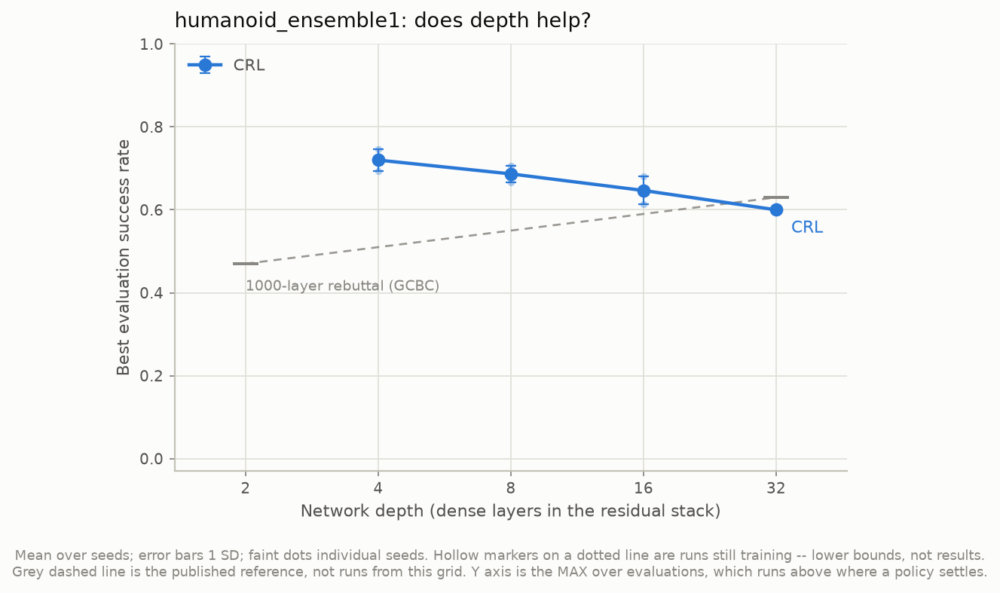
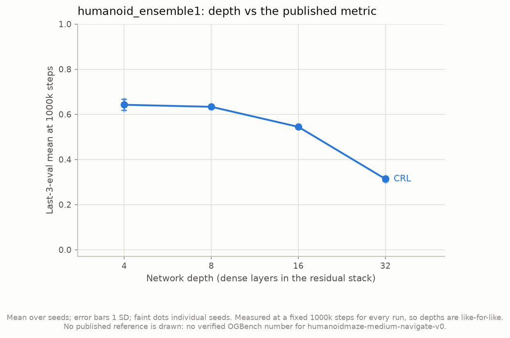
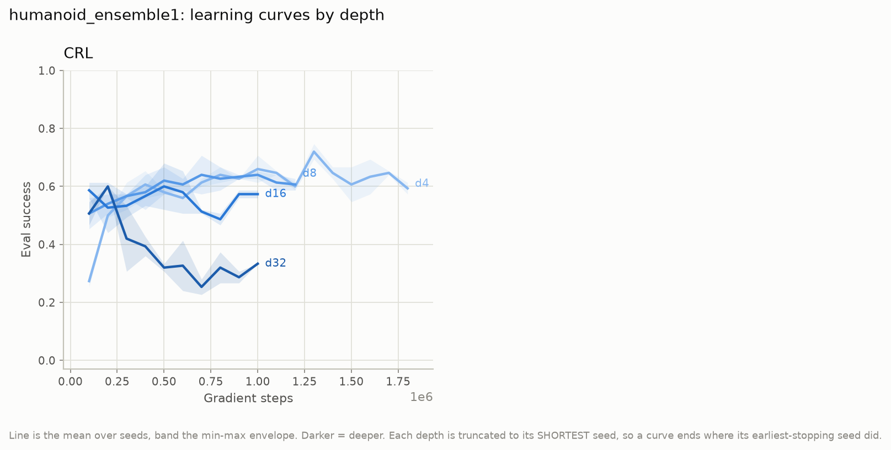
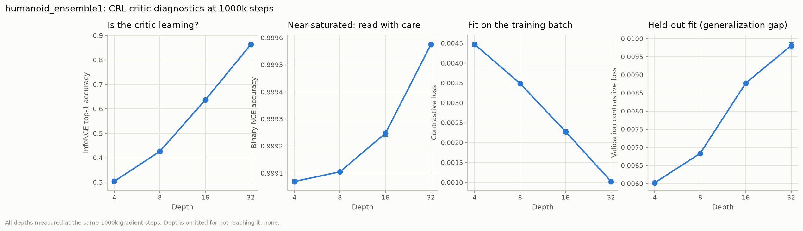
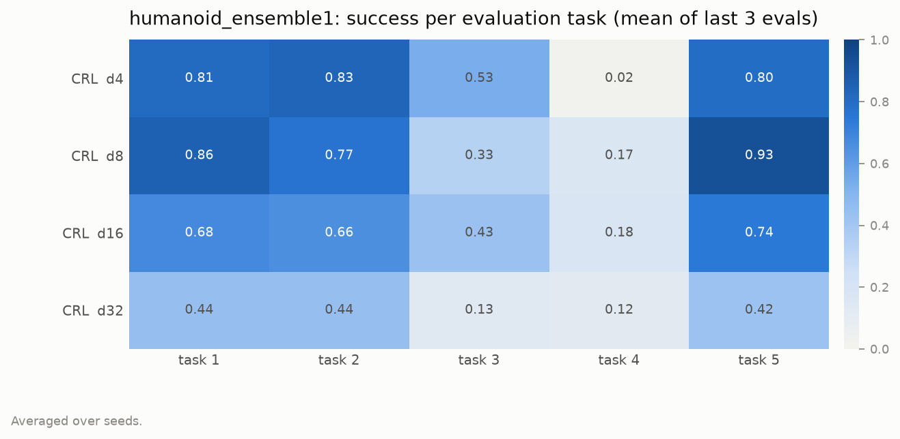
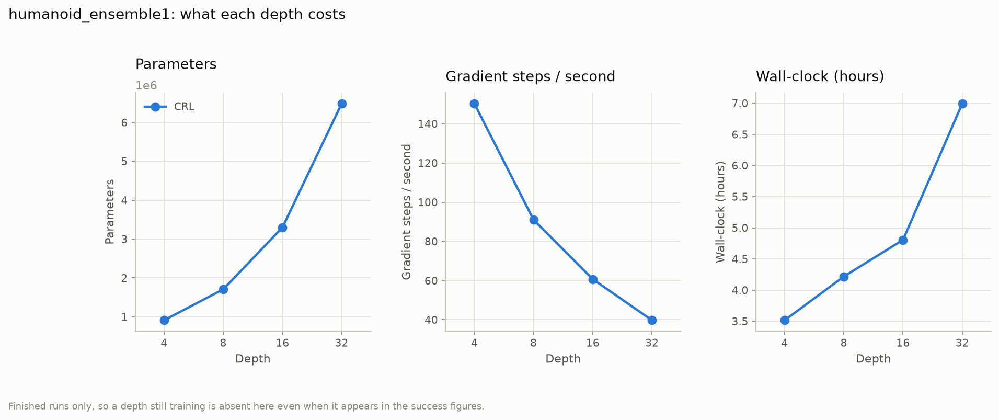

# humanoid_ensemble1 — does the depth result survive a change of environment?

Compiled 2026-11-06. **8 of 8 runs finished** (CRL, depths 4/8/16/32, 2 seeds each) on
`humanoidmaze-medium-navigate-v0`.

Figures are in this folder, PNG + CSV. Every number below is read from those CSVs; the
tables are not typed from terminal output.

> **Headline: the depth result reverses here.** On `antmaze-medium-stitch`, CRL rises
> with depth on every metric — 35.5 → 86.7 at the published 50 episodes/task. On
> `humanoidmaze-medium-navigate` it does not:
>
> | metric | d4 | d8 | d16 | d32 |
> |---|---|---|---|---|
> | **`reeval@50`** (best checkpoint, 250 ep) | 62.0 | **65.0** | 55.0 | 53.0 |
> | `best_success` (best checkpoint, 75 ep) | **72.0** | 68.7 | 64.7 | 60.0 |
> | `last3@1M` (where it settles, 75 ep) | **64.2** | 63.3 | 54.4 | **31.3** |
>
> **The three metrics disagree, and that disagreement is the finding.** On the headline
> metric the peak is at depth *8*, not 4, and depth 32 still reaches 53% — this is a
> 12-point decline from peak, not a collapse. On where the runs *settle*, depth 32 is
> at 31.3%. Depth 32 is the only cell in either grid whose final score falls far below
> its own best checkpoint (−21.7 points; every other cell is within ±2.2). So what
> depth does here is not mainly "learn worse" — it is **fail to stay**.
>
> **And the critic is not what fails — on its training objective.** Training retrieval
> accuracy rises monotonically with depth, in both environments and by a similar margin
> (30.4 → 86.3 here, 36.9 → 80.9 on antmaze). But **held-out** retrieval moves the other
> way here: 0.150 → 0.094, a 37% fall, where antmaze's holds flat at ~0.10. §3.1 is the
> detail, and it is the sharpest single contrast between the two grids.
>
> **Read §4 before quoting any of this.** This grid differs from `phase1_repro` in
> **three** ways, not one, so it does not isolate the environment.

---

## 1. What is different from `phase1_repro`

`experiments/humanoid_ensemble1.yaml` describes itself as changing the dataset and
`critic_ensemble`. Read from the two runs' own `config.json`, there are **four**
substantive differences:

| | `phase1_repro` | `humanoid_ensemble1` | in the YAML? |
|---|---|---|---|
| dataset | `antmaze-medium-stitch-v0` | `humanoidmaze-medium-navigate-v0` | yes |
| `critic_ensemble` | 2 | **1** | yes |
| `discount` | 0.99 | **0.995** | **no** |
| `actor_p_trajgoal / actor_p_randomgoal` | 0.5 / 0.5 | **1.0 / 0.0** | **no** |
| *(consequences, not knobs)* | | | |
| seeds | 3 | 2 | yes |
| observation / action dim | 29 / 8 | 69 / 21 | — |
| trajectories × length | 5000 × 201 | 1000 × 2001 | — |

**Two of the four are not in the YAML at all.** `use_published_flags` applies OGBench's
published CRL command for whichever dataset is named, and for
`humanoidmaze-medium-navigate` that sets `discount = 0.995` (doubling the geometric
goal-sampling horizon) and leaves `actor_p_trajgoal/randomgoal` at `1.0/0.0`, against
stitch's published `0.5/0.5`. Both are the right settings to run — they are what the
published numbers were measured with — but each is a thing that moved silently.

**The fourth may matter most, and was found last.** `actor_p_randomgoal = 0` means the
actor is **never trained on out-of-trajectory goals**. That is precisely the stitching
capability, and task 4 — the task that needs it — never works on humanoid at any depth
(§5). Any explanation of the reversal has to reckon with this before reaching for the
body.

So "depth helps on antmaze and hurts on humanoidmaze" is not what these two grids
support. What they support is: **the configuration that scales on antmaze does not scale
here.** §4 lists what would separate the causes.

Two more differences worth holding, because they cut the other way:

- `-navigate` is not `-stitch`. Its trajectories are 2001 rows, so a single trajectory
  can cover a whole route and far less stitching is required. Stitching is exactly what
  CRL's depth bought on antmaze (§7 of
  [`../antmaze_stitch__depth/README.md`](../antmaze_stitch__depth/README.md)), so there may simply be less
  of that work to do here.
- The maze is the *same* 8×8 grid with the same five (start, goal) cell pairs. The body
  and the data changed; the geometry did not.

---

## 2. Success vs depth

`reeval_50ep.json` — best checkpoint rescored at OGBench's published 50 episodes/task
(250 per point), the only numbers comparable to their table:

| depth | n | mean | SD | seeds |
|---|---|---|---|---|
| 4 | 2 | 62.0 | 1.2 | 63.2, 60.8 |
| 8 | 2 | **65.0** | 1.0 | 66.0, 64.0 |
| 16 | 2 | 55.0 | 5.8 | 60.8, 49.2 |
| 32 | 2 | 53.0 | 7.0 | 60.0, 46.0 |

Note the seed spread widening with depth — ±1.0 at depth 8, ±7.0 at depth 32. The two
depth-32 seeds differ by 14 points, so the depth-16-vs-32 difference is not resolvable
with 2 seeds.

`fig1_success_vs_depth.csv`, max over evaluations, 15 episodes/task × 5 tasks:

| depth | n | mean | SD | seeds |
|---|---|---|---|---|
| 4 | 2 | **0.720** | 0.027 | 0.693, 0.747 |
| 8 | 2 | 0.687 | 0.020 | 0.707, 0.667 |
| 16 | 2 | 0.647 | 0.033 | 0.613, 0.680 |
| 32 | 2 | 0.600 | 0.000 | 0.600, 0.600 |

`fig1b_last3_vs_depth.csv`, mean of the final three evaluations pinned to a common
1,000,000 steps — the metric OGBench's table uses, and the one to quote:

| depth | n | mean | SD | seeds |
|---|---|---|---|---|
| 4 | 2 | **0.642** | 0.024 | 0.618, 0.667 |
| 8 | 2 | 0.633 | 0.007 | 0.627, 0.640 |
| 16 | 2 | 0.544 | 0.007 | 0.538, 0.551 |
| 32 | 2 | 0.313 | 0.011 | 0.302, 0.324 |

The two metrics disagree about *how* bad depth 32 is, and the disagreement is the
finding. Best-eval says 60.0%; settled says 31.3%. §3 is why.

---

## 3. Deeper networks peak earlier and then come apart

From each run's `summary.json`, the step at which the best evaluation occurred:

| depth | seed 0 | seed 1 | best eval | settled (last3) | gap |
|---|---|---|---|---|---|
| 4 | 1,300,000 | 1,300,000 | 0.720 | 0.642 | −0.08 |
| 8 | 700,000 | 500,000 | 0.687 | 0.633 | −0.05 |
| 16 | 100,000 | 500,000 | 0.647 | 0.544 | −0.10 |
| 32 | 200,000 | 200,000 | 0.600 | 0.313 | **−0.29** |

Depth 32 reaches its best score at 200k steps — one fifth of the way in — and then loses
half of it. Depth 4 peaks at 1.3M and holds. **The peak moves earlier as depth
increases, and the fall after it gets worse.** This is why the metrics disagree:
`best_success` and `reeval@50` both score `params_best`, i.e. the pre-collapse peak,
while last3 reports where the run actually ended up.

The gap between those two is the cleanest single number in this grid:

| depth | `reeval@50` (best ckpt) | `last3@1M` (settled) | gap |
|---|---|---|---|
| 4 | 62.0 | 64.2 | −2.2 |
| 8 | 65.0 | 63.3 | +1.7 |
| 16 | 55.0 | 54.4 | +0.6 |
| 32 | 53.0 | 31.3 | **+21.7** |

Only depth 32 ends far below its own best checkpoint. That is a training-stability
failure, not a capacity failure, and it is the one finding here with an immediate cheap
remedy: **early-stop at the peak.** The checkpoints already exist, so that costs nothing
to check.

Every run stopped on `plateau`, not on the step cap, and `plateau_min_steps` is
1,000,000 — so each deep run was *required* to keep training for ~800k steps past its
own peak. That is a configuration choice interacting with the finding, not a property of
depth: a depth-32 run early-stopped at its peak would have scored 0.600, not 0.313.

### 3.1 The critic, in detail — it does not get worse, it stops generalising

**What the three logged critic metrics actually are.** All come from one **1024×1024**
logit matrix per batch (`lib/ogbench/impls/agents/crl.py:42`): every
`φ(sᵢ,aᵢ)·ψ(gⱼ)/√d` pair in the batch. The diagonal is the true future goal; the other
1023 entries in each row are goals from *other* trajectories.

| metric | definition | chance level | units |
|---|---|---|---|
| `categorical_accuracy` | top-1 retrieval: does the true goal outrank the other 1023? | 1/1024 ≈ **0.001** | fraction, 0–1 |
| `contrastive_loss` | sigmoid BCE over all 1024² entries, diagonal labelled 1 | — | nats/entry |
| `binary_accuracy` | fraction of all 1024² entries on the correct side of 0 | **0.99902** | fraction, 0–1 |

> **`binary_accuracy` is close to a null metric — do not read it.** 1023/1024 of the
> matrix is negatives, so "predict negative everywhere" already scores 0.99902. The
> values here (0.99907 → 0.99958) look flat *and* look excellent; both impressions are
> wrong. Backing the true-positive rate out of the excess over base rate gives
> **≥4.8% → ≥57%** across d4 → d32 — a real 12× change hidden behind two decimal
> places.

**Training metrics at 1,000,000 gradient steps** (mean over seeds), antmaze beside for
scale:

| metric | d4 | d8 | d16 | d32 | direction |
|---|---|---|---|---|---|
| categorical accuracy, **train** (humanoid) | 0.304 | 0.426 | 0.637 | **0.863** | ↑ with depth |
| categorical accuracy, **train** (antmaze) | 0.369 | 0.467 | 0.607 | 0.809 | ↑ with depth |
| contrastive loss, **train** (humanoid) | 0.00447 | 0.00349 | 0.00228 | **0.00103** | ↓ (fits better) |
| contrastive loss, **val** (humanoid) | 0.00602 | 0.00683 | 0.00877 | **0.00981** | ↑ (generalises worse) |
| contrastive loss, **val** (antmaze) | 0.00530 | 0.00549 | 0.00642 | 0.00856 | ↑ (generalises worse) |

**The result is in the held-out column, which the figure above does not plot.** From
`train.csv`, which logs validation versions of all of these:

| depth | retrieval, **train** | retrieval, **val** | logit margin, train | logit margin, val |
|---|---|---|---|---|
| 4 | 0.304 | **0.150** | 7.73 | 5.79 |
| 8 | 0.426 | 0.116 | 10.41 | 6.40 |
| 16 | 0.637 | 0.101 | 14.26 | 6.57 |
| 32 | **0.863** | **0.094** | 18.51 | 6.00 |

*Retrieval is `categorical_accuracy`, a fraction 0–1 against a chance level of 0.001.
Margin is mean positive logit − mean negative logit, in **logits**, scale arbitrary per
run and comparable only down a column.*

Depth nearly **triples** training retrieval and **cuts held-out retrieval by 37%**. The
training margin grows 2.4×; the held-out margin does not move at all. The depth-32
critic is not learning a better value function — it is learning to identify *which
training trajectory* a goal came from.

The antmaze contrast is the control that makes this a finding rather than a
restatement of overfitting:

| depth | retrieval train (antmaze) | retrieval **val** (antmaze) |
|---|---|---|
| 4 | 0.369 | 0.105 |
| 32 | 0.809 | 0.101 |

Antmaze overfits too — but its held-out retrieval holds **flat**. Humanoid's degrades.

### 3.2 It turns over when control does

Validation retrieval through training, mean over seeds:

- **d4:** 0.149 → 0.150 across the whole 1M steps. Dead flat. This is the
  best-controlling configuration.
- **d32:** peaks at **100k (0.135)**, then decays to 0.082.

Task success for d32 peaks at **200k** and then sheds half its score. The critic's
held-out retrieval peaks 100k *before* that and falls for the rest of training. These
are the same phenomenon.

### 3.3 Why this dataset specifically

Three properties make the trajectory-identity shortcut cheap here, all of them
dataset facts rather than anything about depth. Measured from the npz files:

| | antmaze-stitch | humanoidmaze-navigate |
|---|---|---|
| trajectories | 5,000 | **1,000** |
| trajectory length | 201 rows | **2,001 rows** |
| observation dim | 29 | **69** |

Five times fewer trajectories to memorise, each ten times longer, described by a state
with more than twice the dimensions — a humanoid's pose and joint velocities are a far
more distinctive fingerprint than an ant's. Since the in-batch negatives are almost all
drawn from *other* trajectories, "which trajectory is this?" solves the training task
without any spatial understanding. At 512 epochs over the data there is ample
opportunity to find it.

**This is testable and is being tested**: `antmaze_navigate__depth` is the ant body on
navigate data (1000 × 1001), which has this structure without the humanoid.

### 3.4 And nothing damps the consequence

`critic_ensemble: 1` matters more than it looks. The actor maximises `min` over the
ensemble (`src/offline/critic_losses.py:214`), and with a single critic `_reduce_q` is
a **pass-through** — there is no pessimism at all. The actor's whole job is to find
actions where `Q` is high, which means actively seeking the critic's errors, and a
deeper critic has sharper, more confident ones. Antmaze had the `min` over two.

The actor's own metrics agree independently: humanoid held-out behaviour-cloning MSE
gets *worse* with depth (0.0804 → 0.0884) while antmaze's improves a lot
(0.1453 → 0.0750).

**This is covered by `antmaze_stitch__depth_ensemble1`**, running now.

### 3.5 What the direct probes say

[`../interp__critic_depth/`](../interp__critic_depth/) has now run on this grid. The
short version, with the full tables and controls in that folder: the humanoid critic's
representation encodes geodesic distance **well** and far above an untrained baseline,
and still controls badly — so linear decodability of maze geometry is not what
separates the two environments either.

---|---|---|---|---|---|
| categorical accuracy (humanoid) | 0.304 | 0.426 | 0.637 | **0.863** | ↑ with depth |
| categorical accuracy (antmaze) | 0.369 | 0.467 | 0.607 | 0.809 | ↑ with depth |
| train contrastive loss (humanoid) | 0.00447 | 0.00349 | 0.00228 | **0.00103** | ↓ (better fit) |
| **val** contrastive loss (humanoid) | 0.00602 | 0.00683 | 0.00877 | **0.00981** | ↑ (worse) |
| **val** contrastive loss (antmaze) | 0.00530 | 0.00549 | 0.00642 | 0.00856 | ↑ (worse) |

Train and validation contrastive loss move in *opposite* directions as depth grows, in
both environments: the deeper critic fits the training objective better and generalises
worse. The humanoid runs make 512–1024 passes over 2M transitions, so there is ample
opportunity.

But note what this does **not** explain. The train/val decoupling is present on antmaze
too, at a similar magnitude, and there depth still helped. Overfitting of the contrastive
objective is therefore not sufficient on its own to produce the reversal — something
about how this critic converts into actions has to differ. That is what
[`../interp01/`](../interp__critic_depth/) is built to measure, and it has not yet been run on this
grid (§5).

---

## 4. What would actually separate the causes

The reversal has at least five candidate explanations, and this grid cannot distinguish
them:

1. **The body.** 69-D observations and 21-D actions instead of 29/8; a humanoid falls
   over, an ant does not.
2. **`critic_ensemble = 1`.** A single critic encoder pair, where antmaze had two. The
   interp metrics already show the ensemble mean is a slightly better-ordered field than
   a single head, so removing the ensemble plausibly costs more at depth.
3. **`discount = 0.995`.** A longer goal-sampling horizon changes which goals the critic
   is trained on, and deep networks may be more sensitive to that.
4. **Less stitching required.** `-navigate`'s long trajectories mean the skill depth
   bought on antmaze may not be needed.
5. **`actor_p_randomgoal = 0`.** The actor never sees an out-of-trajectory goal, so the
   stitching behaviour is not trained for at all — a stronger version of (4), and the
   one with no experiment covering it yet.

The cheapest discriminating run is **antmaze-medium-stitch with `critic_ensemble: 1`**,
depths 4 and 32, 2 seeds — 4 runs. If depth still scales there, (2) is cleared and the
cause is environmental. If it does not, the antmaze result depended on the ensemble and
the headline from `phase1_repro` needs qualifying.

Second cheapest: **humanoidmaze with `critic_ensemble: 2`**, same 4 points, which tests
(2) in the other direction.

Neither has been run. Both are ~4 runs rather than the 8 here, because only the two
endpoint depths are needed to establish the sign.

---

## 5. Per task

`reeval_50ep.json`, best checkpoint, 50 episodes/task — and this is the table to read,
because at 15 episodes a single task's score moves in steps of 0.067:

| depth | task 1 | task 2 | task 3 | **task 4** | task 5 |
|---|---|---|---|---|---|
| 4 | 0.910 | 0.870 | 0.530 | **0.010** | 0.780 |
| 8 | 0.870 | 0.840 | 0.360 | **0.260** | 0.920 |
| 16 | 0.740 | 0.710 | 0.440 | **0.080** | 0.780 |
| 32 | 0.790 | 0.530 | 0.440 | **0.240** | 0.650 |

Against antmaze CRL on the same metric, where task 4 is the whole story:

| depth | task 1 | task 2 | task 3 | **task 4** | task 5 |
|---|---|---|---|---|---|
| 4 | 0.167 | 0.553 | 0.773 | **0.080** | 0.200 |
| 8 | 0.060 | 0.067 | 0.907 | **0.687** | 0.940 |
| 16 | 0.493 | 0.753 | 0.900 | **0.827** | 0.900 |
| 32 | 0.660 | 0.767 | 0.960 | **0.973** | 0.973 |

**Task 4 — the forced 180° detour — goes 0.08 → 0.97 with depth on antmaze and never
exceeds 0.26 on humanoid at any depth.** That one row is the reversal in its sharpest
form: the capability depth buys on antmaze is exactly the one it never buys here.

`fig6_per_task.csv`, best checkpoint, 15 episodes/task:

| config | task 1 | task 2 | task 3 | task 4 | task 5 |
|---|---|---|---|---|---|
| CRL d4 | 0.811 | 0.833 | 0.533 | **0.022** | 0.800 |
| CRL d8 | 0.856 | 0.767 | 0.333 | 0.167 | 0.933 |
| CRL d16 | 0.678 | 0.656 | 0.433 | 0.178 | 0.744 |
| CRL d32 | 0.444 | 0.444 | 0.133 | 0.122 | 0.422 |

Two things to read here:

- **The decline is uniform, not one task breaking.** Tasks 1, 2 and 5 each lose roughly
  half their success from d4 to d32. An aggregate that fell because one task collapsed
  would be a different (and smaller) finding.
- **Task 4 never works at any depth** (0.02–0.18). Task 4 is the forced 180° detour —
  the start and goal are positioned so the straight-line direction is the wrong way. On
  antmaze this is precisely the task CRL's depth *unlocked*, going 0.133 → 0.933 across
  d4 → d32. Here depth never buys it. That single cell is the sharpest statement of the
  reversal in the whole grid.

---

## 6. Cost

`fig4_cost.csv`:

| depth | params | steps/s | wall clock (h) | peak RSS (GB) |
|---|---|---|---|---|
| 4 | 912,277 | 145–155 | 3.4–3.6 | 2.29 |
| 8 | 1,707,925 | 82–100 | 3.3–5.1 | 2.35 |
| 16 | 3,299,221 | 60–62 | 4.7–4.9 | 2.51 |
| 32 | 6,481,813 | ~40 | 7.0 | 2.57 |

Depth 32 costs 7.1× the parameters and 2× the wall clock of depth 4 to score 12 points
lower on best-eval and 33 points lower settled. On this grid, depth is a pure loss.

---

## 7. Status and what is pending

- **Figures: complete.** All 6 regenerate with
  `python src/scripts/plot_results.py --grid humanoid_ensemble1`, which also publishes
  them into this folder.
- **`reeval_50ep.json` is being measured** (job `2995118`, 8 runs × 250 episodes). Until
  it lands, this document quotes the 15-episodes/task training evaluations, which are
  *not* comparable to OGBench's published table. The reeval table will appear in this
  folder and the headline should be restated from it.
- **`interp01` has not been run on this grid.** The eval suite is pinned to
  `grids: [phase1_repro]`. Running the critic heatmap here is the direct test of the §3.1
  question — whether a critic that scores better on its own objective is nonetheless a
  worse-ordered value field — and it needs only `grids: [humanoid_ensemble1]` in
  `src/offline/evals/evals.yaml`.

### Defects found while compiling this

1. `experiments/humanoid_ensemble1.yaml`'s header says the depth sweep "drops 32". All
   four depths including 32 ran. The comment is stale.
2. The same header says the changes from `phase1_repro` are "only these" and lists two;
   `discount` also differs, via `use_published_flags`. The YAML notes the discount
   separately, lower down, but the "only these" list is wrong as written.
3. **`fig1b` was drawing the wrong published reference.** `plot_results.py` held
   OGBench's `antmaze-medium-stitch` numbers (CRL 0.53, GCBC 0.45) as a bare
   `{agent: value}` constant and shaded them onto *every* grid — so this grid's chart
   invited a comparison against a different environment's published result. The
   constant is now keyed by dataset, a grid with no verified number gets no band, and
   the caption says so. Only `antmaze-medium-stitch-v0` is listed, because it is the
   only one verified (research_log §766).
