# interp01 — critic interpretability results

<!-- AUTO:meta -->
**Suite** `interp01` · **generated** 2026-11-06 15:15 · **8 checkpoints**

| | |
|---|---|
| datasets | `antmaze-medium-stitch-v0`, `humanoidmaze-medium-navigate-v0` |
| grids | phase1_repro, humanoid_ensemble1 |
| states | 26,148 from `humanoidmaze-medium-navigate-v0-val.npz` (val, held out) |
| binning | 4x per cell = 1.00 world units; 416/416 free bins cleared the state floor |
| goals | 8 draws per task (`add_noise_to_goal=True`, so the goal is a distribution) |
| actions | `policy`, `oracle_geodesic`, `oracle_euclid`, `dataset` |
| oracle | `humanoid` / `params_40000000.pkl` — the policy that generated this dataset |
| compute | 2.3 min total across 8 checkpoints |
<!-- /AUTO:meta -->

> **Status:** complete for both environments — 16/16 evals, 4 depths × 2 environments
> × 2 evals. Caveats in §6 stand, **one seed per depth above all**.
>
> ### The one-line result
>
> **Depth does not help by making the critic a better distance function — on antmaze it
> measurably makes it worse, by two independent measurements — and the single metric
> that tracks behaviour is which *action* the critic prefers where going around a wall
> and going straight at the goal disagree.**
>
> | measurement | antmaze (success 35.5 → 86.7) | humanoidmaze (success 62.0 → 53.0) |
> |---|---|---|
> | field ordering, ρ(Q, −geodesic) | **falls** 0.647 → 0.393 | flat/high 0.69 → 0.72 |
> | probe for geodesic, over untrained | **falls to −0.043** | large, flat +0.51 → +0.47 |
> | **prefers the maze-correct action** | **rises −0.051 → +0.090** | **negative at every depth** |
>
> The first two rows move *opposite* to behaviour. The third moves *with* it, in both
> environments, and predicts the per-task result (antmaze task 4: 0.08 → 0.97;
> humanoid task 4: never above 0.26).

---

## 1. What was measured

Depth helps the offline CRL critic a lot on `antmaze-medium-stitch` (`reeval@50`
35.5 → 53.2 → 77.5 → 86.7 at depths 4/8/16/32) and hurts on
`humanoidmaze-medium-navigate` (62.0 → 65.0 → 55.0 → 53.0). The policy is extracted by
DDPG+BC, so **every bit of that signal arrives through `Q(s, a, g)`**. These evals ask
what about `Q` differs.

Full method:
[`critic_heatmap/README.md`](../../src/offline/evals/critic_heatmap/README.md). In one
line each:

- **Value landscape** — does `Q` rank maze positions by *geodesic* distance to the goal
  rather than straight-line distance? (`topology_gain`)
- **Action preference** — in the bins where "go around the wall" and "go straight at the
  goal" are different actions, which does the critic score higher?
  (`action_topology_gain`)
- **Extraction** — does the actor's own action beat the maze-correct one under its own
  critic? (`oracle_gap`)

The maze-correct and straight-line actions come from **OGBench's own
direction-conditioned SAC expert — the policy that generated every action in these
datasets** — so they are real actions, not a hand-built controller.

### Units, and how to read every table below

| quantity | meaning | units | range |
|---|---|---|---|
| `ρ(Q, −geodesic)` | Spearman rank correlation between the critic value in a bin and its negative BFS distance to the goal | dimensionless | [−1, 1], higher = better ordered |
| `topology_gain` | `ρ_geodesic − ρ_euclid`: does the field respect walls, or only straight-line distance? | dimensionless | >0 = respects walls |
| `action_topology_gain` | `Q(maze-correct action) − Q(straight-at-goal action)` | **logits** | >0 = prefers going around |
| `oracle_gap` | `Q(policy action) − Q(geodesic expert action)` | **logits** | >0 = actor outscores the expert |
| `path_monotone` | fraction of steps along the optimal path where `Q` increases | fraction | [0, 1] |
| `goal_percentile` | percentile rank of the goal bin within the field | fraction | [0, 1], 1 = goal is the max |
| `coverage` | fraction of free maze bins with enough held-out states to measure | fraction | a control; constant down a column |
| probe `R²` | variance explained for a held-out *trajectory*, against the test mean | dimensionless | ≤ 1, may be negative |
| probe `accuracy` | top-1 over 26 maze cells | fraction | chance = largest class, not 1/26 |

**`Q` is an unnormalised log-density ratio**: `φ(s,a)ᵀψ(g)/√d`. Its scale is arbitrary
per run, so every logit-valued quantity is comparable in **sign and trend only**, never
in level, and never across runs. Every field panel is normalised on its own 2nd–98th
percentile and prints its raw range.

**Rows are depths; one row per (environment, depth).** Each row is the single best seed
at that depth, chosen by `reeval@50` — §2 shows the full seed set and the spread,
because picking a best seed out of three is a real choice.

## 2. Checkpoints

One per (agent, depth), chosen by the rule in the suite file. The whole seed set is
shown because the between-seed spread is comparable to some depth gaps.

<!-- AUTO:checkpoints -->
**`humanoid_ensemble1`** — `humanoidmaze-medium-navigate-v0`

| depth | seed | score | rule | all seeds | spread | run |
|---|---|---|---|---|---|---|
| 4 | 1 | 0.747 | `best_success@0` | s0=0.693, s1=0.747 | 0.053 | `humanoid_ensemble1__crl__d4__n1000000__s1__1bce0b09` |
| 8 | 0 | 0.707 | `best_success@0` | s0=0.707, s1=0.667 | 0.040 | `humanoid_ensemble1__crl__d8__n1000000__s0__a857e3c3` |
| 16 | 1 | 0.680 | `best_success@0` | s0=0.613, s1=0.680 | 0.067 | `humanoid_ensemble1__crl__d16__n1000000__s1__a7dcc884` |
| 32 | 0 | 0.600 | `best_success@0` | s0=0.600, s1=0.600 | 0.000 | `humanoid_ensemble1__crl__d32__n1000000__s0__d1da46a4` |

**`phase1_repro`** — `antmaze-medium-stitch-v0`

| depth | seed | score | rule | all seeds | spread | run |
|---|---|---|---|---|---|---|
| 4 | 1 | 0.444 | `reeval@50` | s0=0.376, s1=0.444, s2=0.208 | 0.236 | `phase1_repro__crl__d4__n1000000__s1__acdde8ae` |
| 8 | 2 | 0.580 | `reeval@50` | s0=0.544, s1=0.516, s2=0.580 | 0.064 | `phase1_repro__crl__d8__n1000000__s2__43511f71` |
| 16 | 2 | 0.904 | `reeval@50` | s0=0.728, s1=0.720, s2=0.904 | 0.184 | `phase1_repro__crl__d16__n1000000__s2__c674fc85` |
| 32 | 2 | 0.907 | `best_success@0` | s0=0.827, s1=0.880, s2=0.907 | 0.080 | `phase1_repro__crl__d32__n1000000__s2__c92f51af` |
<!-- /AUTO:checkpoints -->

---

## 3. `critic_heatmap`

### 3.1 The value field

<!-- AUTO:img_fig1_critic_field -->
**`humanoid_ensemble1`**

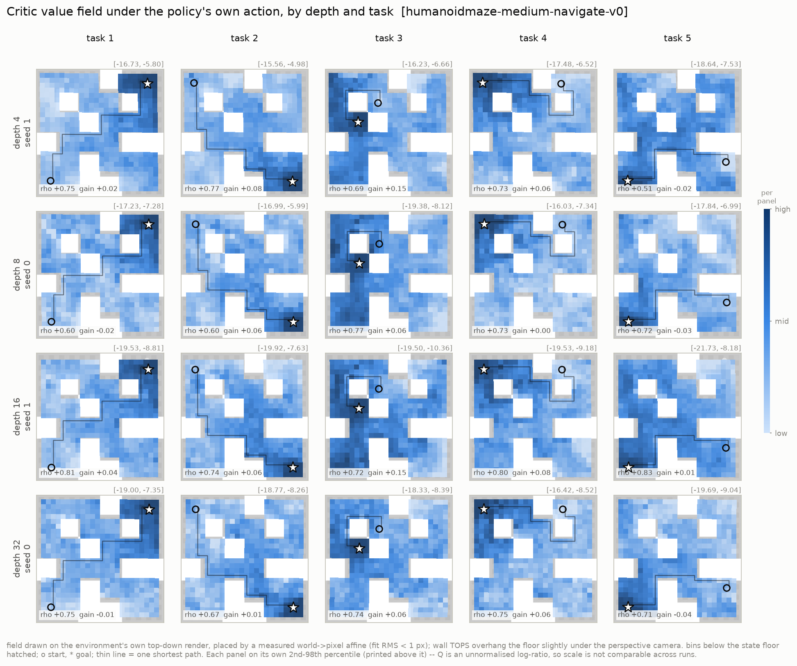

**`phase1_repro`**

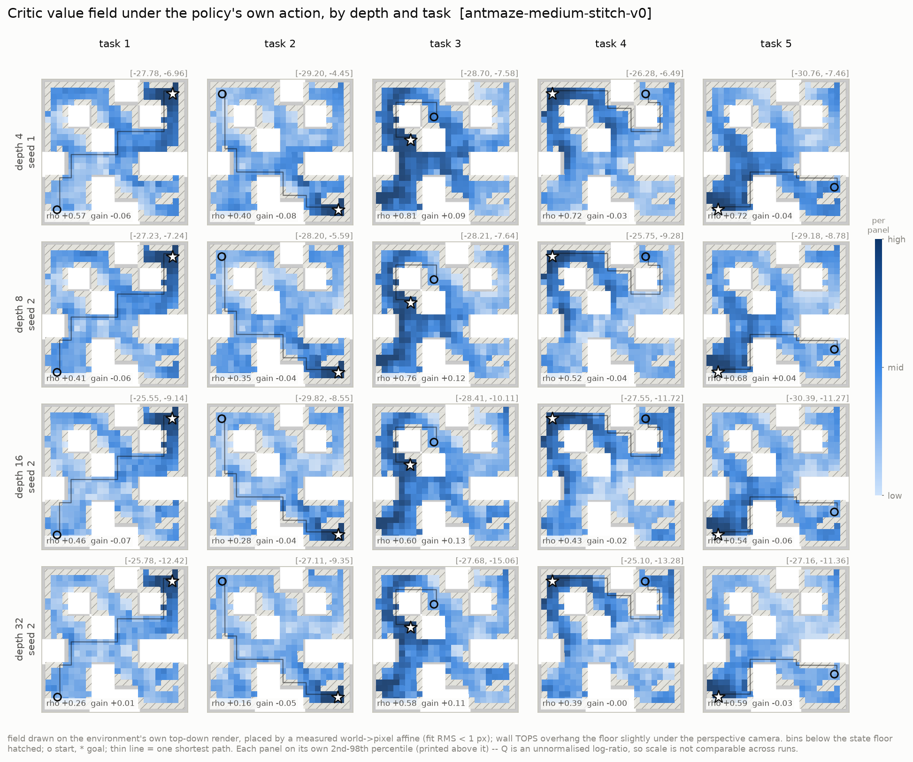
<!-- /AUTO:img_fig1_critic_field -->

`Q(s, π(s,g), g)` per spatial bin, drawn on the environment's own top-down render.
Walls are the white blocks; hatched bins fell below the state floor and enter no metric.
Each panel is normalised on its own 2nd–98th percentile — `Q` is an unnormalised
log-ratio, so **only the shape is comparable across rows**, never the magnitude.

> **Read.** Both environments produce a recognisable value bowl around the goal, so
> nothing here is broken. The difference is in the *trend down the column*: on antmaze
> the field gets visibly flatter and noisier with depth while success rises, and on
> humanoidmaze it stays well-formed at every depth while success falls. Whatever depth
> is doing for control on antmaze, it is not visible as a better-looking field.
>
> Note the `coverage` control: **0.69 on antmaze, 1.00 on humanoidmaze.** The humanoid
> dataset's 2001-step trajectories visit every free bin of the maze; antmaze-stitch's
> 201-step ones reach 285 of 416. Coverage is constant down each column, so it cannot
> be driving any depth trend — but it does mean the two environments' panels are not
> measured on the same set of bins.

### 3.2 Does the field follow the maze?

<!-- AUTO:img_fig2_topology -->
**`humanoid_ensemble1`**

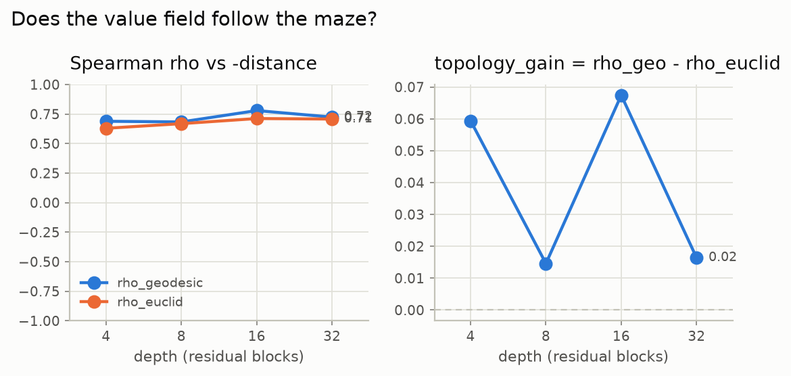

**`phase1_repro`**

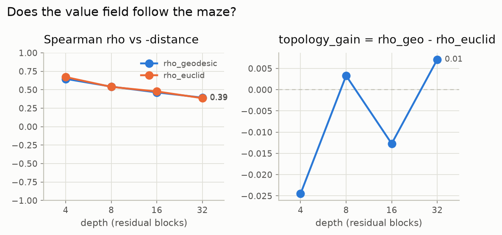
<!-- /AUTO:img_fig2_topology -->

<!-- AUTO:topology -->
**`humanoid_ensemble1`** — `humanoidmaze-medium-navigate-v0`

| depth | ρ(Q, −geodesic) | ρ(Q, −euclid) | topology_gain | bins | coverage |
|---|---|---|---|---|---|
| 4 | 0.689 | 0.629 | **+0.059** | 416 | 1.00 |
| 8 | 0.683 | 0.669 | **+0.015** | 416 | 1.00 |
| 16 | 0.779 | 0.712 | **+0.067** | 416 | 1.00 |
| 32 | 0.724 | 0.708 | **+0.016** | 416 | 1.00 |

Units: ρ is dimensionless in [−1, 1]; `topology_gain` is their difference. `coverage` is a control and must be identical across rows.

**`phase1_repro`** — `antmaze-medium-stitch-v0`

| depth | ρ(Q, −geodesic) | ρ(Q, −euclid) | topology_gain | bins | coverage |
|---|---|---|---|---|---|
| 4 | 0.647 | 0.672 | **-0.025** | 285 | 0.69 |
| 8 | 0.542 | 0.539 | **+0.003** | 285 | 0.69 |
| 16 | 0.464 | 0.476 | **-0.013** | 285 | 0.69 |
| 32 | 0.393 | 0.386 | **+0.007** | 285 | 0.69 |

Units: ρ is dimensionless in [−1, 1]; `topology_gain` is their difference. `coverage` is a control and must be identical across rows.
<!-- /AUTO:topology -->

`topology_gain = ρ(Q, −geodesic) − ρ(Q, −euclid)`. Straight-line distance is nearly free
from the observation (`(x,y)` is dims 0:2 of both `s` and `g`); geodesic distance needs
the walls. The difference is the part of the ranking that cannot be explained by
subtracting coordinates. Positive = the field bends around walls.

> **Read. This is the first place the two environments invert, and not in the
> direction one would guess.**
>
> On **antmaze**, `ρ(Q, −geodesic)` falls monotonically with depth, **0.647 → 0.542 →
> 0.464 → 0.393**, while `reeval@50` rises 35.5 → 86.7. The deeper, far better critic
> orders maze positions by true distance-to-goal *less* well.
>
> On **humanoidmaze**, ρ is both **higher** (0.68–0.78) and **flat-to-rising**, while
> success falls. The environment whose field is better ordered by distance is the one
> that controls worse.
>
> `topology_gain` (ρ_geodesic − ρ_euclid) is ≈ 0 on antmaze at every depth and mildly
> positive on humanoidmaze. So neither critic strongly prefers geodesic structure over
> straight-line structure as a *field*; §3.4 asks the same question about *actions* and
> gets a much sharper answer.
>
> **Conclusion: being a better distance function is not how depth helps.** Taken with
> §4, where the same inversion appears in the linear probes, two independent
> measurements agree on this.

### 3.3 Where the field peaks, and whether it climbs

<!-- AUTO:img_fig4_metrics -->
**`humanoid_ensemble1`**

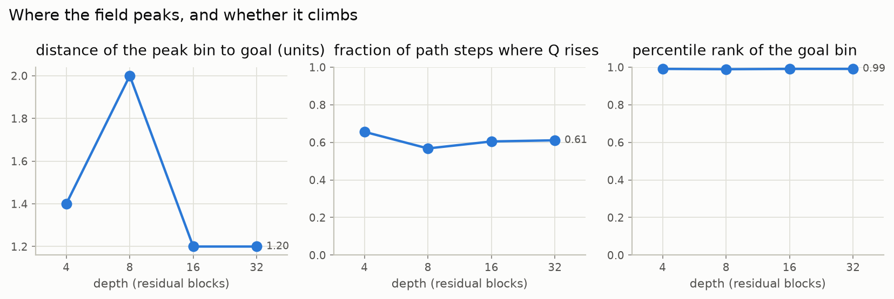

**`phase1_repro`**

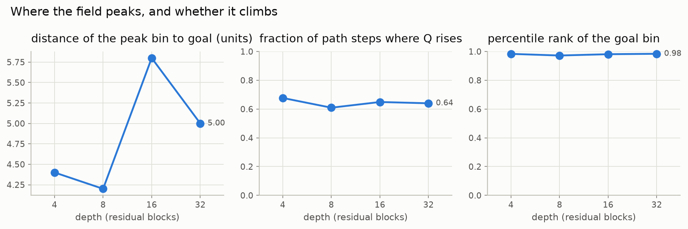
<!-- /AUTO:img_fig4_metrics -->

<!-- AUTO:field -->
**`humanoid_ensemble1`** — `humanoidmaze-medium-navigate-v0`

| depth | peak_geodesic | top5_geodesic | path_monotone | goal_percentile | q_std | ens_gap |
|---|---|---|---|---|---|---|
| 4 | 1.40 | 3.08 | 0.656 | 0.991 | 2.366 | — |
| 8 | 2.00 | 3.31 | 0.568 | 0.989 | 2.311 | — |
| 16 | 1.20 | 3.48 | 0.605 | 0.991 | 2.510 | — |
| 32 | 1.20 | 3.03 | 0.611 | 0.991 | 2.226 | — |

Units: the two `*_geodesic` columns are **world units** (0 is perfect); `path_monotone` and `goal_percentile` are fractions; `q_std` and `ens_gap` are **logits** and are not comparable across rows — read `ens_gap` relative to `q_std` in the same row.

**`phase1_repro`** — `antmaze-medium-stitch-v0`

| depth | peak_geodesic | top5_geodesic | path_monotone | goal_percentile | q_std | ens_gap |
|---|---|---|---|---|---|---|
| 4 | 4.40 | 4.46 | 0.677 | 0.983 | 5.201 | 3.889 |
| 8 | 4.20 | 4.09 | 0.609 | 0.972 | 4.659 | 4.450 |
| 16 | 5.80 | 4.29 | 0.649 | 0.981 | 4.167 | 4.464 |
| 32 | 5.00 | 4.04 | 0.640 | 0.984 | 3.225 | 4.423 |

Units: the two `*_geodesic` columns are **world units** (0 is perfect); `path_monotone` and `goal_percentile` are fractions; `q_std` and `ens_gap` are **logits** and are not comparable across rows — read `ens_gap` relative to `q_std` in the same row.
<!-- /AUTO:field -->

`path_monotone` is the property DDPG+BC actually needs: the actor does one-step greedy
improvement, so a field can rank well globally and still trap it in a local basin.

> **Read.** `goal_percentile` is high everywhere (the goal bin is near the top of the
> field, as it must be for anything to work), and `peak_geodesic` shows the field's
> maximum sitting a few world units from the true goal rather than on it — in both
> environments, at all depths. `path_monotone` is the one that matters for extraction,
> because DDPG+BC does one-step greedy improvement: a field can rank well globally and
> still trap the actor in a local basin. It sits well below 1.0 throughout, which is a
> standing caveat on every "the critic is good" statement here.

### 3.3b Where the policy's action beats the logged one

`Q(policy action) − Q(dataset action)`, per bin. Needs `dataset` in `action_sources`;
without it the figure has no data and `figures.py` skips it rather than drawing an
empty panel.

<!-- AUTO:img_fig3_advantage_field -->
**`humanoid_ensemble1`**

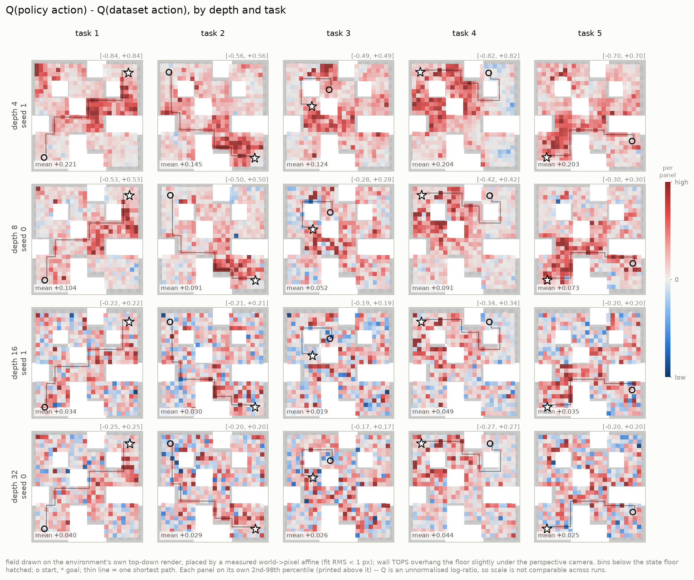

**`phase1_repro`**

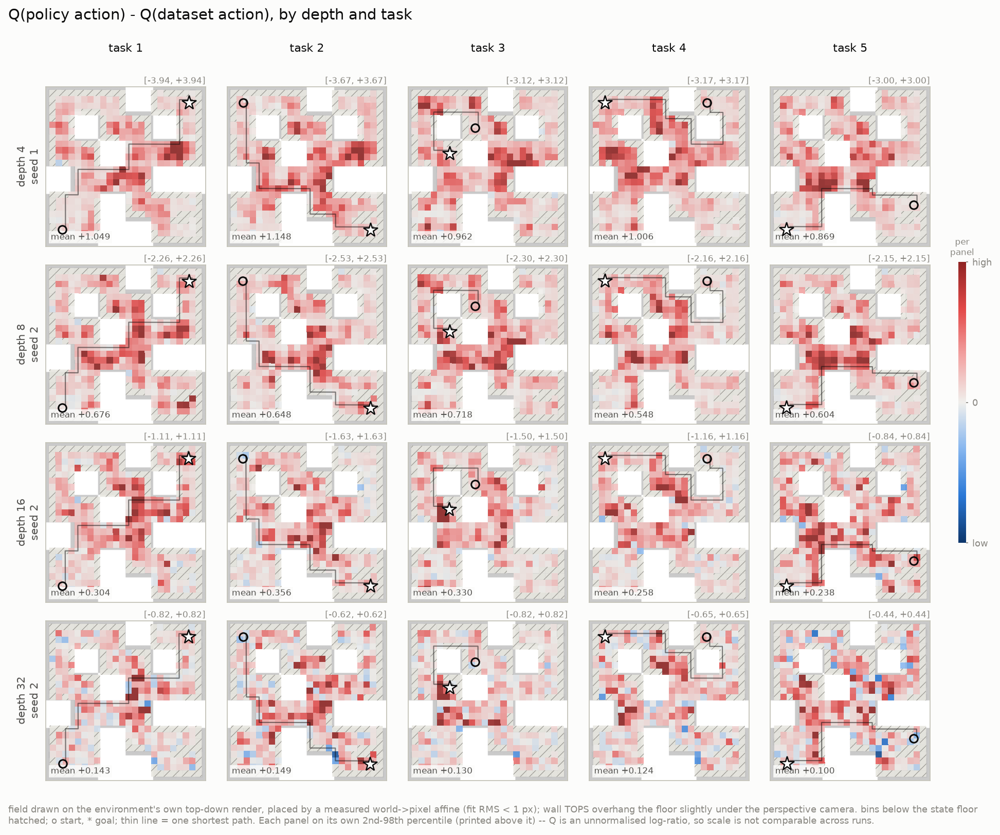
<!-- /AUTO:img_fig3_advantage_field -->

> **Read.** `Q(policy action) − Q(dataset action)` is the sanity check that policy
> extraction is doing something: the actor is trained to maximise `Q`, so it should
> generally outscore the logged action under the critic's own judgement. It does, and
> the field is mostly positive in both environments. This panel exists mainly so that a
> *negative* region would be visible; read §3.4 for the comparison that discriminates.

### 3.4 Which action does the critic prefer?

<!-- AUTO:img_fig5_action_preference -->
**`humanoid_ensemble1`**

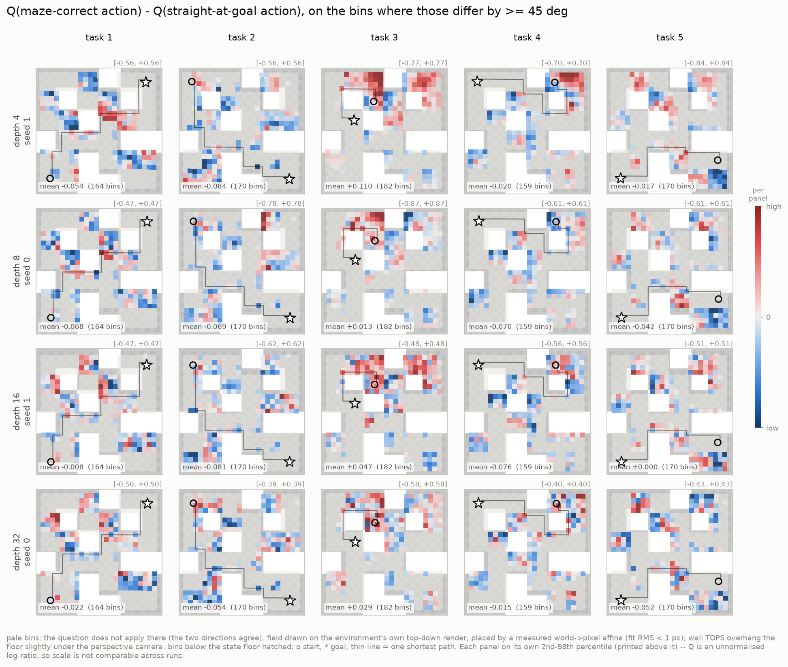

**`phase1_repro`**

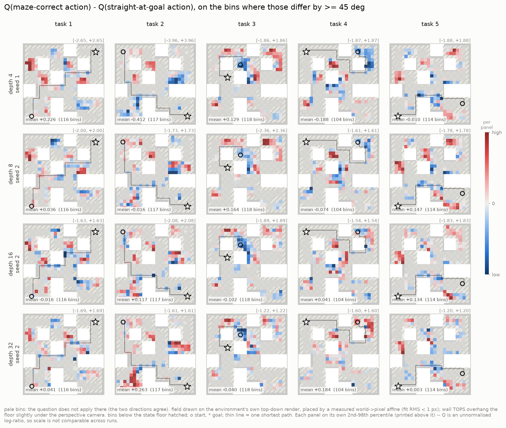
<!-- /AUTO:img_fig5_action_preference -->

`Q(maze-correct action) − Q(straight-at-goal action)`, on the bins where those two
directions differ by at least the split angle. Bins where they agree are drawn **pale**
(the question does not apply); bins with no data stay **hatched** (we do not know).

<!-- AUTO:img_fig6_action_tests -->
**`humanoid_ensemble1`**

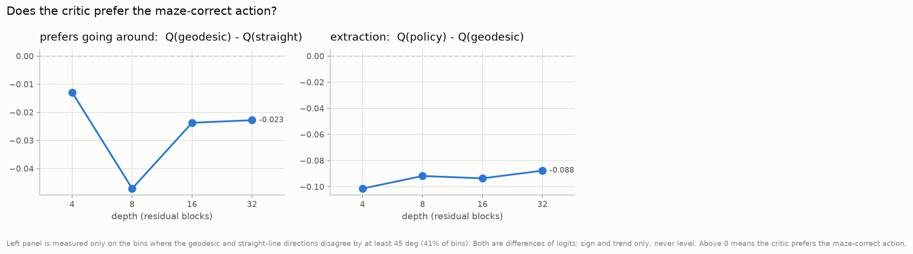

**`phase1_repro`**

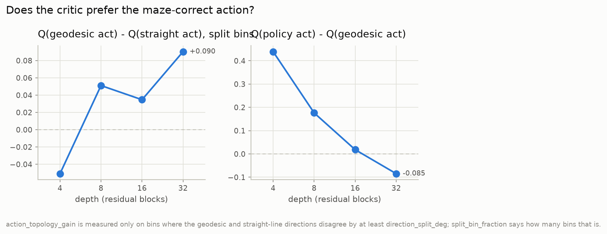
<!-- /AUTO:img_fig6_action_tests -->

<!-- AUTO:action -->
**`humanoid_ensemble1`** — `humanoidmaze-medium-navigate-v0`

| depth | action_topology_gain | (all bins) | oracle_gap | (split bins) | split bin fraction |
|---|---|---|---|---|---|
| 4 | **-0.013** | -0.005 | -0.101 | -0.051 | 0.41 |
| 8 | **-0.047** | -0.018 | -0.092 | -0.043 | 0.41 |
| 16 | **-0.024** | -0.009 | -0.094 | -0.055 | 0.41 |
| 32 | **-0.023** | -0.012 | -0.088 | -0.066 | 0.41 |

Units: **logits**, so sign and trend only. `action_topology_gain` is restricted to bins where the geodesic and straight-line directions disagree by at least 45°; the `(all bins)` column is the same quantity without that restriction, as a check that the restriction concentrates the signal rather than creating it.

**`phase1_repro`** — `antmaze-medium-stitch-v0`

| depth | action_topology_gain | (all bins) | oracle_gap | (split bins) | split bin fraction |
|---|---|---|---|---|---|
| 4 | **-0.051** | -0.006 | +0.439 | +0.607 | 0.40 |
| 8 | **+0.051** | +0.043 | +0.176 | +0.226 | 0.40 |
| 16 | **+0.035** | +0.027 | +0.018 | +0.077 | 0.40 |
| 32 | **+0.090** | +0.045 | -0.085 | -0.028 | 0.40 |

Units: **logits**, so sign and trend only. `action_topology_gain` is restricted to bins where the geodesic and straight-line directions disagree by at least 45°; the `(all bins)` column is the same quantity without that restriction, as a check that the restriction concentrates the signal rather than creating it.
<!-- /AUTO:action -->

`oracle_gap` needs the success rate beside it: DDPG+BC maximises `Q`, so `> 0` is the
default and only says extraction worked. **`< 0` = extraction failure** (the actor is
not at its own critic's argmax). **`> 0` with low success = critic failure** (the actor
faithfully maximises a quantity whose maximiser is wrong).

> **Read. This is the headline of the whole suite.**
>
> `action_topology_gain` = `Q(maze-correct action) − Q(straight-at-goal action)`, in
> **logits**, measured only on the ~40% of bins where those two directions disagree by
> ≥ 45°. Both actions are real: they come from OGBench's own direction-conditioned
> expert, the policy that generated every action in these datasets.
>
> | depth | antmaze | humanoidmaze |
> |---|---|---|
> | 4 | −0.051 | −0.013 |
> | 8 | +0.051 | −0.047 |
> | 16 | +0.035 | −0.024 |
> | 32 | **+0.090** | −0.023 |
>
> **On antmaze it crosses zero and rises with depth. On humanoidmaze it is negative at
> every depth.** The antmaze critic progressively learns to prefer going *around the
> wall*; the humanoid critic always prefers heading *straight at the goal*, which in a
> maze means into a wall.
>
> That is exactly the capability task 4 needs — its start is a dead end whose only exit
> points 180° away from the goal — and it predicts the per-task numbers precisely:
> antmaze task 4 goes **0.08 → 0.97** with depth, humanoid never exceeds **0.26**. Of
> everything measured in this suite, this is the metric that separates the two
> environments in the same direction as behaviour.
>
> **`oracle_gap`** = `Q(policy action) − Q(geodesic expert action)` tells the
> extraction half. On antmaze it falls **+0.439 → +0.176 → +0.018 → −0.085**: the
> shallow critic rates its own actor far above the data-generating expert, and by depth
> 32 it rates them the same. Read as convergence, not failure — depth 32 is also the
> best-performing cell. On humanoidmaze it is **negative at every depth** (−0.09 to
> −0.10): the actor never reaches its own critic's preferred action, so some of that
> grid's loss is extraction, not just the critic.

### 3.5 Per task

Task 4 is the one to look at: its start `(6,5)` is a dead end whose only exit points
**180° away** from the goal, and GCBC scores 0.00 on it.

<!-- AUTO:pertask -->
**`humanoid_ensemble1`** — `humanoidmaze-medium-navigate-v0`

| metric | depth | task 1 | task 2 | task 3 | task 4 | task 5 |
|---|---|---|---|---|---|---|
| action_topology_gain | 4 | -0.054 | -0.084 | +0.110 | -0.020 | -0.017 |
| action_topology_gain | 8 | -0.068 | -0.069 | +0.013 | -0.070 | -0.042 |
| action_topology_gain | 16 | -0.008 | -0.081 | +0.047 | -0.076 | +0.000 |
| action_topology_gain | 32 | -0.022 | -0.054 | +0.029 | -0.015 | -0.052 |
| topology_gain | 4 | +0.021 | +0.080 | +0.150 | +0.063 | -0.016 |
| topology_gain | 8 | -0.021 | +0.060 | +0.055 | +0.004 | -0.026 |
| topology_gain | 16 | +0.041 | +0.056 | +0.154 | +0.079 | +0.007 |
| topology_gain | 32 | -0.007 | +0.011 | +0.063 | +0.055 | -0.041 |
| path_monotone | 4 | 0.625 | 0.600 | 0.889 | 0.559 | 0.607 |
| path_monotone | 8 | 0.550 | 0.550 | 0.667 | 0.500 | 0.571 |
| path_monotone | 16 | 0.550 | 0.550 | 0.722 | 0.559 | 0.643 |
| path_monotone | 32 | 0.600 | 0.475 | 0.778 | 0.559 | 0.643 |

Task starts and goals: **1** (1, 1)→(6, 6); **2** (6, 1)→(1, 6); **3** (5, 3)→(4, 2); **4** (6, 5)→(6, 1); **5** (2, 6)→(1, 1)

**`phase1_repro`** — `antmaze-medium-stitch-v0`

| metric | depth | task 1 | task 2 | task 3 | task 4 | task 5 |
|---|---|---|---|---|---|---|
| action_topology_gain | 4 | +0.226 | -0.412 | +0.129 | -0.188 | -0.010 |
| action_topology_gain | 8 | +0.036 | -0.016 | +0.164 | -0.074 | +0.147 |
| action_topology_gain | 16 | -0.016 | +0.117 | -0.102 | +0.041 | +0.134 |
| action_topology_gain | 32 | +0.041 | +0.263 | -0.040 | +0.184 | +0.003 |
| topology_gain | 4 | -0.058 | -0.083 | +0.085 | -0.031 | -0.036 |
| topology_gain | 8 | -0.058 | -0.044 | +0.123 | -0.041 | +0.035 |
| topology_gain | 16 | -0.072 | -0.043 | +0.127 | -0.018 | -0.057 |
| topology_gain | 32 | +0.007 | -0.049 | +0.108 | -0.005 | -0.026 |
| path_monotone | 4 | 0.583 | 0.629 | 0.667 | 0.800 | 0.706 |
| path_monotone | 8 | 0.611 | 0.571 | 0.667 | 0.550 | 0.647 |
| path_monotone | 16 | 0.583 | 0.571 | 0.833 | 0.550 | 0.706 |
| path_monotone | 32 | 0.639 | 0.571 | 0.833 | 0.450 | 0.706 |

Task starts and goals: **1** (1, 1)→(6, 6); **2** (6, 1)→(1, 6); **3** (5, 3)→(4, 2); **4** (6, 5)→(6, 1); **5** (2, 6)→(1, 1)
<!-- /AUTO:pertask -->

> **Read.** The aggregate hides a phase transition on antmaze and hides nothing on
> humanoidmaze. Task 4 is the discriminating cell in both the behaviour tables and
> §3.4's action preference, and tasks 1/2/5 on humanoid decline roughly uniformly with
> depth rather than one task collapsing — so the humanoid result is a broad degradation
> plus one capability that never appears, not a single broken task.

---

## 4. `state_probes`

Do `φ(s,a)` and `ψ(g)` *linearly* encode position, maze cell and geodesic distance,
above a raw-input and an untrained-network baseline? This and `critic_heatmap` can
disagree, which is the interesting case — a representation can carry geodesic distance
linearly while the dot product fails to use it.

Design: [`state_probes/README.md`](../../src/offline/evals/state_probes/README.md).
Which target belongs to which site, and why `raw_obs` differs per site, is in
`impl.py`'s docstring: `φ` and `ψ` never see each other, so a pair property is probed
from their concatenation and a goal property is computed on the goal observation.

<!-- AUTO:img_fig1_probe_vs_depth -->
**`humanoid_ensemble1`**

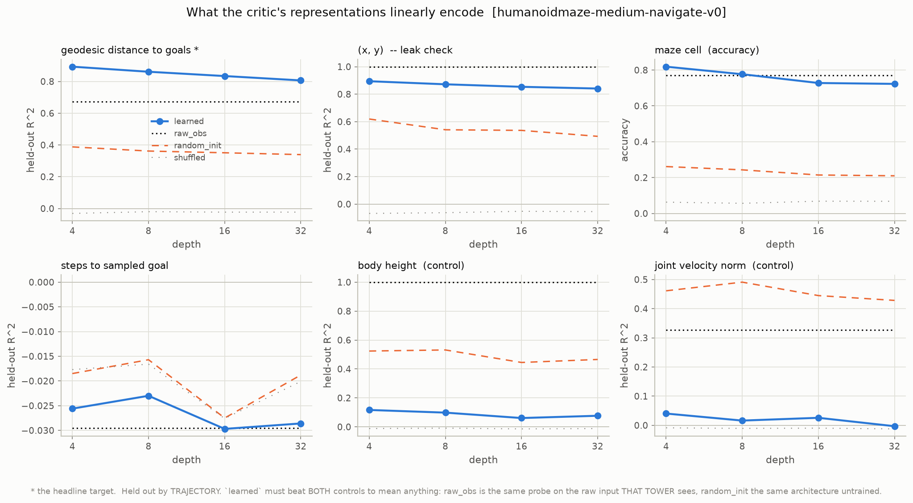

**`phase1_repro`**

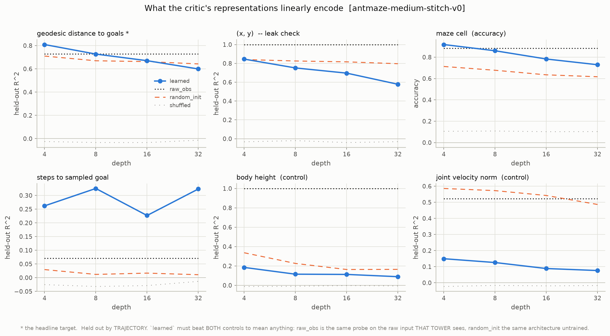
<!-- /AUTO:img_fig1_probe_vs_depth -->

<!-- AUTO:probes -->
**`humanoid_ensemble1`** — `humanoidmaze-medium-navigate-v0`

| depth | geo R² φ | geo R² raw | geo R² rand | geo R² ψ | cell acc φ | vel R² φ (ctrl) | shuffled |
|---|---|---|---|---|---|---|---|
| 4 | 0.893 | 0.672 | 0.388 | 0.909 | 0.819 | 0.040 | -0.031 |
| 8 | 0.861 | 0.672 | 0.362 | 0.891 | 0.777 | 0.016 | -0.020 |
| 16 | 0.834 | 0.672 | 0.351 | 0.863 | 0.728 | 0.026 | -0.023 |
| 32 | 0.806 | 0.672 | 0.339 | 0.840 | 0.723 | -0.003 | -0.023 |

**`phase1_repro`** — `antmaze-medium-stitch-v0`

| depth | geo R² φ | geo R² raw | geo R² rand | geo R² ψ | cell acc φ | vel R² φ (ctrl) | shuffled |
|---|---|---|---|---|---|---|---|
| 4 | 0.809 | 0.730 | 0.710 | 0.905 | 0.918 | 0.149 | -0.025 |
| 8 | 0.727 | 0.730 | 0.669 | 0.897 | 0.860 | 0.126 | -0.033 |
| 16 | 0.670 | 0.730 | 0.662 | 0.867 | 0.783 | 0.088 | -0.034 |
| 32 | 0.599 | 0.730 | 0.642 | 0.815 | 0.729 | 0.076 | -0.013 |

Held out by TRAJECTORY. `φ` must beat BOTH `raw` (the same probe on the raw input that tower sees) and `rand` (the same architecture untrained) to have added anything. `shuffled` is the leak check and must sit at or below 0.
<!-- /AUTO:probes -->

> **Read. The probes agree with §3.2, by a second and independent route.**
>
> The number to read is **`geo R² φ` minus `geo R² rand`** — how much the *trained*
> representation adds over an untrained network of the same depth. A deep random tower
> is already a good linear basis, so the raw score alone means little.
>
> | depth | antmaze advantage | humanoidmaze advantage |
> |---|---|---|
> | 4 | +0.099 | +0.505 |
> | 8 | +0.058 | +0.499 |
> | 16 | +0.008 | +0.483 |
> | 32 | **−0.043** | +0.467 |
>
> **On antmaze the advantage vanishes by depth 16 and is negative at 32** — the
> depth-32 representation encodes geodesic distance *worse than an untrained network of
> the same depth*, and worse than the raw 29-d observation (0.730), while success is at
> its best. **On humanoidmaze the advantage is large and stays large**, in the grid
> that controls worst.
>
> Two cautions. First, *everything* becomes less linearly decodable with depth on
> antmaze, including the velocity control (0.149 → 0.076), so the finding is the
> relative one — geodesic decodability falls faster than its own untrained baseline and
> crosses it — not the absolute decline. Second, absolute R² is not comparable *across*
> environments (different goal distributions, different observation spaces); only the
> within-environment trend and the gap to each environment's own controls are sound.
>
> The controls behave: `shuffled` sits at −0.03 to +0.00 everywhere, and `geo R² raw`
> is constant down each column as it must be, since it is the same input at every
> depth.

### 4.1 Does the representation explain the value field?

`geodesic_to_task` probe R² against the same checkpoint's `rho_geodesic`. Moving
together would give the heatmap result a representational mechanism; moving apart says
the information is present and the dot product does not use it.

<!-- AUTO:img_fig2_probe_vs_heatmap -->
**`humanoid_ensemble1`**

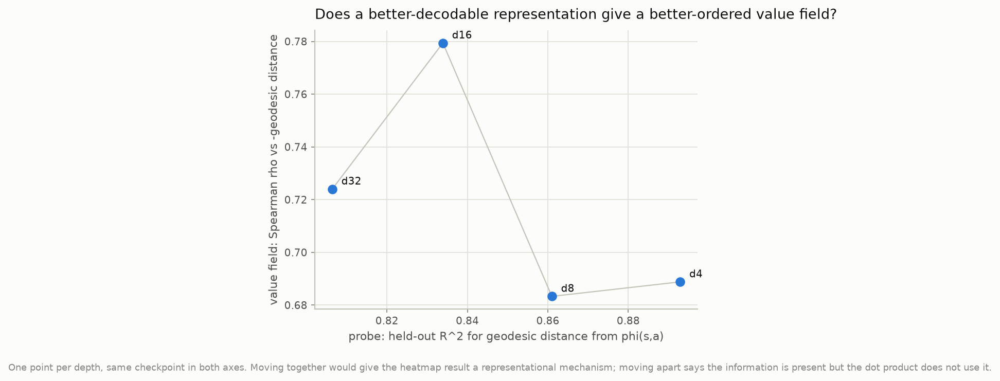

**`phase1_repro`**

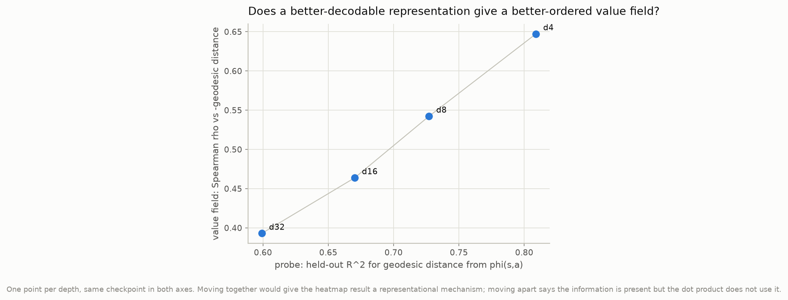
<!-- /AUTO:img_fig2_probe_vs_heatmap -->

> **Read.** The two move *together* on antmaze — probe R² and field ordering both fall
> with depth — which is self-consistent but means neither explains the rise in success.
> They are measuring the same underlying thing (how linearly the geometry sits in the
> representation) rather than two independent facts, so this panel is best read as a
> consistency check that passed, not as a mechanism.
>
> **What remains unexplained, and is the question to take forward:** if the field is
> less distance-ordered and the representation less distance-decodable, what does depth
> improve? §3.4 is the only metric here that moves with behaviour, and it is about
> *action preference at a fixed state*, not about the geometry of the field. That
> points at the `φ(s,a)·ψ(g)` interaction — how `Q` varies with `a` at fixed `(s, g)` —
> which none of these figures measures directly. A `dQ/da` eval is the obvious next
> one.

---

## 5. Reproduce

<!-- AUTO:reproduce -->
```bash
src/eval.py                     # the plan: which checkpoints, which evals
src/eval.py --submit            # queue the job
src/eval.py --status            # per-task state
src/eval.py --figures           # redraw from finished tasks
src/eval.py --report            # regenerate THIS file (prose is preserved)
```

Suite file: [`evals.yaml`](evals.yaml). Raw output: `/scratch/gpfs/vt7993/rl-scaling/experiments/analysis/evals/interp01`
(`field.npz`, `metrics.json`, `meta.json`, `maze_render.png` per checkpoint).
<!-- /AUTO:reproduce -->

---

## 6. Caveats

1. **One seed per depth.** The spread between seeds at a given depth is in §2 and is
   comparable to some depth gaps. Until `seed_select: all` is run, a per-depth number
   is partly a statement about that seed. This is the caveat that most limits every
   trend above, including the headline one.
2. **`Q`'s scale is arbitrary per run.** `topology_gain` is a difference of rank
   correlations and is safe to compare; `action_topology_gain` and `oracle_gap` are in
   **logits** and are comparable in sign and trend only — never in level, and never
   across runs.
3. **Two environments, not a controlled contrast.** The grids behind them differ in
   **four** ways — dataset, `critic_ensemble`, `discount`, and
   `actor_p_trajgoal/randomgoal` — so *no* difference between the two columns is
   attributable to the environment. Two of the four have a dedicated experiment
   (`antmaze_stitch__depth_ensemble1`, running; `antmaze_navigate__depth`, ready);
   two do not. See
   [`../humanoidmaze_navigate__depth_ensemble1/README.md`](../humanoidmaze_navigate__depth_ensemble1/README.md)
   §1.
4. **The two environments are not measured on the same bins.** `coverage` is 1.00 on
   humanoidmaze (all 416 free bins) and 0.69 on antmaze (285 of 416), because
   2001-step trajectories visit the whole maze and 201-step ones do not. Coverage is
   constant *down* each column, so it cannot drive a depth trend, but it does mean
   cross-environment levels are not strictly like-for-like.
5. **Not a causal test.** A critic can rank bins correctly and still extract a bad
   policy; `oracle_gap` is the closest thing here to separating the two. Nothing in
   this suite intervenes on the critic and measures the behavioural consequence.
6. **Figures are one complete set per environment.** No panel pools the two and no
   colour scale is shared, for the reason in caveat 2.
7. **`path_monotone` is well below 1.0 everywhere.** DDPG+BC does one-step greedy
   improvement, so a field can rank correctly end-to-end and still trap the actor.
   Every "the field is well ordered" statement above is subject to this.
8. **The probes are linear by construction.** "Not linearly decodable" is not "not
   represented" — §4's result bounds what a *linear* readout of `φ` or `ψ` alone can
   recover, and `Q` is a product of the two, which is strictly more expressive.

<!-- AUTO:provenance -->
---

<sub>
Figures are drawn on each environment's own top-down render. The world→pixel map is measured, not derived, and its accuracy differs per environment:

| environment | calib points | affine fit RMS | leave-one-out max | image | floor correction |
|---|---|---|---|---|---|
| `humanoidmaze-medium-navigate-v0` | 9 | **2.412 px** | **6.715 px** | 480 px | `(d−z)/d = 0.95` at z = 1.5 |
| `antmaze-medium-stitch-v0` | 9 | **0.686 px** | **1.669 px** | 480 px | `(d−z)/d = 0.972182` at z = 0.8345 |

Oracle actions for `humanoidmaze-medium-navigate-v0`: `/scratch/gpfs/vt7993/ogbench/experts/humanoid` (`params_40000000.pkl`, trained on `online-humanoid-xy-v0`). 
Oracle actions for `antmaze-medium-stitch-v0`: `/scratch/gpfs/vt7993/ogbench/experts/ant` (`params_400000.pkl`, trained on `online-ant-xy-v0`). 
Metrics self-check: `python -m offline.evals.critic_heatmap.impl`. Generated by `src/eval.py --report`.
</sub>
<!-- /AUTO:provenance -->
