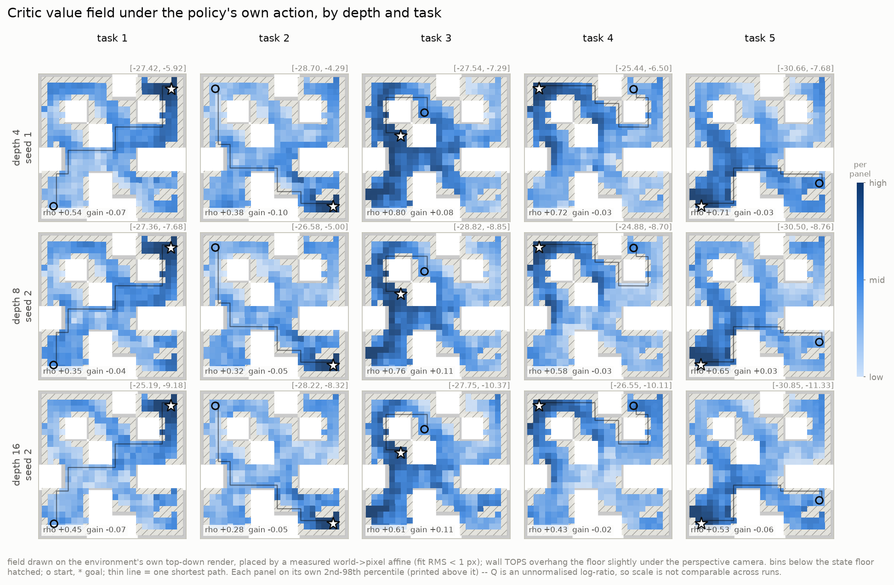

# interp01 — critic interpretability results

<!-- AUTO:meta -->
**Suite** `interp01` · **generated** 2026-11-06 14:52 · **8 checkpoints**

| | |
|---|---|
| datasets | `antmaze-medium-stitch-v0`, `humanoidmaze-medium-navigate-v0` |
| grids | phase1_repro, humanoid_ensemble1 |
| states | 26,148 from `humanoidmaze-medium-navigate-v0-val.npz` (val, held out) |
| binning | 4x per cell = 1.00 world units; 416/416 free bins cleared the state floor |
| goals | 8 draws per task (`add_noise_to_goal=True`, so the goal is a distribution) |
| actions | `policy`, `oracle_geodesic`, `oracle_euclid`, `dataset` |
| oracle | `humanoid` / `params_40000000.pkl` — the policy that generated this dataset |
| compute | 2.3 min total across 8 checkpoints |
<!-- /AUTO:meta -->

> **Status:** draft, and **being superseded as of 2026-11-06**. Everything below was
> measured on a **3-depth** ladder (4/8/16), because depth 32 had not finished training
> when the suite ran. It has now finished, and job `2995119` re-runs all four depths
> behind the rescore that picks their seeds. Two things change when it lands:
>
> - **A fourth point at depth 32**, which matters most for §3.2: ρ falls monotonically
>   over 4 → 8 → 16, and whether that continues is the whole question.
> - **`fig3_advantage_field` appears.** It was absent, not broken: it plots
>   Q(policy) − Q(dataset), and the suite requested only `policy`, `oracle_geodesic` and
>   `oracle_euclid` as action sources, so the figure had no data and `figures.py`
>   correctly skipped it. `dataset` has been added to `action_sources`.
>
> The caveats in §6 stand regardless — one seed per depth above all.

> **The finding that most wants the fourth point.** Across 4 → 8 → 16 the critic's value
> field gets **less** aligned with true geodesic distance (ρ 0.632 → 0.532 → 0.462) while
> task success rises 0.43 → 0.57 → 0.85. Being a better distance function is evidently
> not how depth helps this critic. Meanwhile `oracle_gap` collapses
> (0.443 → 0.174 → 0.036): the deeper the critic, the less it prefers its own actor's
> action over the data-generating expert's. Those two together are the interesting
> result, and both are single-seed.

---

## 1. What was measured

Depth helps the offline CRL critic a lot on `antmaze-medium-stitch`: 34.3 → 54.7 → 78.4
(reeval@50, depths 4/8/16). The policy is extracted by DDPG+BC, so **every bit of that
signal arrives through `Q(s, a, g)`**. These evals ask what about `Q` gets better.

Full method: [`critic_heatmap/README.md`](../../src/offline/evals/critic_heatmap/README.md). In one line each:

- **Value landscape** — does `Q` rank maze positions by *geodesic* distance to the goal
  rather than straight-line distance? (`topology_gain`)
- **Action preference** — in the bins where "go around the wall" and "go straight at the
  goal" are different actions, which does the critic score higher?
  (`action_topology_gain`)
- **Extraction** — does the actor's own action beat the maze-correct one under its own
  critic? (`oracle_gap`)

The maze-correct and straight-line actions come from **OGBench's own
direction-conditioned SAC expert — the policy that generated every action in this
dataset** — so they are real actions, not a hand-built controller.

## 2. Checkpoints

One per (agent, depth), chosen by the rule in the suite file. The whole seed set is
shown because the between-seed spread is comparable to some depth gaps.

<!-- AUTO:checkpoints -->
**`humanoid_ensemble1`** — `humanoidmaze-medium-navigate-v0`

| depth | seed | score | rule | all seeds | spread | run |
|---|---|---|---|---|---|---|
| 4 | 1 | 0.747 | `best_success@0` | s0=0.693, s1=0.747 | 0.053 | `humanoid_ensemble1__crl__d4__n1000000__s1__1bce0b09` |
| 8 | 0 | 0.707 | `best_success@0` | s0=0.707, s1=0.667 | 0.040 | `humanoid_ensemble1__crl__d8__n1000000__s0__a857e3c3` |
| 16 | 1 | 0.680 | `best_success@0` | s0=0.613, s1=0.680 | 0.067 | `humanoid_ensemble1__crl__d16__n1000000__s1__a7dcc884` |
| 32 | 0 | 0.600 | `best_success@0` | s0=0.600, s1=0.600 | 0.000 | `humanoid_ensemble1__crl__d32__n1000000__s0__d1da46a4` |

**`phase1_repro`** — `antmaze-medium-stitch-v0`

| depth | seed | score | rule | all seeds | spread | run |
|---|---|---|---|---|---|---|
| 4 | 1 | 0.444 | `reeval@50` | s0=0.376, s1=0.444, s2=0.208 | 0.236 | `phase1_repro__crl__d4__n1000000__s1__acdde8ae` |
| 8 | 2 | 0.580 | `reeval@50` | s0=0.544, s1=0.516, s2=0.580 | 0.064 | `phase1_repro__crl__d8__n1000000__s2__43511f71` |
| 16 | 2 | 0.904 | `reeval@50` | s0=0.728, s1=0.720, s2=0.904 | 0.184 | `phase1_repro__crl__d16__n1000000__s2__c674fc85` |
| 32 | 2 | 0.907 | `best_success@0` | s0=0.827, s1=0.880, s2=0.907 | 0.080 | `phase1_repro__crl__d32__n1000000__s2__c92f51af` |
<!-- /AUTO:checkpoints -->

---

## 3. `critic_heatmap`

### 3.1 The value field



`Q(s, π(s,g), g)` per spatial bin, drawn on the environment's own top-down render.
Walls are the white blocks; hatched bins fell below the state floor and enter no metric.
Each panel is normalised on its own 2nd–98th percentile — `Q` is an unnormalised
log-ratio, so **only the shape is comparable across rows**, never the magnitude.

> **Read:** _TODO — what changes down the column?_

### 3.2 Does the field follow the maze?


<!-- AUTO:topology -->
**`humanoid_ensemble1`** — `humanoidmaze-medium-navigate-v0`

| depth | ρ(Q, −geodesic) | ρ(Q, −euclid) | topology_gain | bins | coverage |
|---|---|---|---|---|---|
| 4 | 0.689 | 0.629 | **+0.059** | 416 | 1.00 |
| 8 | 0.683 | 0.669 | **+0.015** | 416 | 1.00 |
| 16 | 0.779 | 0.712 | **+0.067** | 416 | 1.00 |
| 32 | 0.724 | 0.708 | **+0.016** | 416 | 1.00 |

Units: ρ is dimensionless in [−1, 1]; `topology_gain` is their difference. `coverage` is a control and must be identical across rows.

**`phase1_repro`** — `antmaze-medium-stitch-v0`

| depth | ρ(Q, −geodesic) | ρ(Q, −euclid) | topology_gain | bins | coverage |
|---|---|---|---|---|---|
| 4 | 0.647 | 0.672 | **-0.025** | 285 | 0.69 |
| 8 | 0.542 | 0.539 | **+0.003** | 285 | 0.69 |
| 16 | 0.464 | 0.476 | **-0.013** | 285 | 0.69 |
| 32 | 0.393 | 0.386 | **+0.007** | 285 | 0.69 |

Units: ρ is dimensionless in [−1, 1]; `topology_gain` is their difference. `coverage` is a control and must be identical across rows.
<!-- /AUTO:topology -->

`topology_gain = ρ(Q, −geodesic) − ρ(Q, −euclid)`. Straight-line distance is nearly free
from the observation (`(x,y)` is dims 0:2 of both `s` and `g`); geodesic distance needs
the walls. The difference is the part of the ranking that cannot be explained by
subtracting coordinates. Positive = the field bends around walls.

> **Read:** _TODO._

### 3.3 Where the field peaks, and whether it climbs


<!-- AUTO:field -->
**`humanoid_ensemble1`** — `humanoidmaze-medium-navigate-v0`

| depth | peak_geodesic | top5_geodesic | path_monotone | goal_percentile | q_std | ens_gap |
|---|---|---|---|---|---|---|
| 4 | 1.40 | 3.08 | 0.656 | 0.991 | 2.366 | — |
| 8 | 2.00 | 3.31 | 0.568 | 0.989 | 2.311 | — |
| 16 | 1.20 | 3.48 | 0.605 | 0.991 | 2.510 | — |
| 32 | 1.20 | 3.03 | 0.611 | 0.991 | 2.226 | — |

Units: the two `*_geodesic` columns are **world units** (0 is perfect); `path_monotone` and `goal_percentile` are fractions; `q_std` and `ens_gap` are **logits** and are not comparable across rows — read `ens_gap` relative to `q_std` in the same row.

**`phase1_repro`** — `antmaze-medium-stitch-v0`

| depth | peak_geodesic | top5_geodesic | path_monotone | goal_percentile | q_std | ens_gap |
|---|---|---|---|---|---|---|
| 4 | 4.40 | 4.46 | 0.677 | 0.983 | 5.201 | 3.889 |
| 8 | 4.20 | 4.09 | 0.609 | 0.972 | 4.659 | 4.450 |
| 16 | 5.80 | 4.29 | 0.649 | 0.981 | 4.167 | 4.464 |
| 32 | 5.00 | 4.04 | 0.640 | 0.984 | 3.225 | 4.423 |

Units: the two `*_geodesic` columns are **world units** (0 is perfect); `path_monotone` and `goal_percentile` are fractions; `q_std` and `ens_gap` are **logits** and are not comparable across rows — read `ens_gap` relative to `q_std` in the same row.
<!-- /AUTO:field -->

`path_monotone` is the property DDPG+BC actually needs: the actor does one-step greedy
improvement, so a field can rank well globally and still trap it in a local basin.

> **Read:** _TODO._

### 3.4 Which action does the critic prefer?


`Q(maze-correct action) − Q(straight-at-goal action)`, on the bins where those two
directions differ by at least the split angle. Bins where they agree are drawn **pale**
(the question does not apply); bins with no data stay **hatched** (we do not know).


<!-- AUTO:action -->
**`humanoid_ensemble1`** — `humanoidmaze-medium-navigate-v0`

| depth | action_topology_gain | (all bins) | oracle_gap | (split bins) | split bin fraction |
|---|---|---|---|---|---|
| 4 | **-0.013** | -0.005 | -0.101 | -0.051 | 0.41 |
| 8 | **-0.047** | -0.018 | -0.092 | -0.043 | 0.41 |
| 16 | **-0.024** | -0.009 | -0.094 | -0.055 | 0.41 |
| 32 | **-0.023** | -0.012 | -0.088 | -0.066 | 0.41 |

Units: **logits**, so sign and trend only. `action_topology_gain` is restricted to bins where the geodesic and straight-line directions disagree by at least 45°; the `(all bins)` column is the same quantity without that restriction, as a check that the restriction concentrates the signal rather than creating it.

**`phase1_repro`** — `antmaze-medium-stitch-v0`

| depth | action_topology_gain | (all bins) | oracle_gap | (split bins) | split bin fraction |
|---|---|---|---|---|---|
| 4 | **-0.051** | -0.006 | +0.439 | +0.607 | 0.40 |
| 8 | **+0.051** | +0.043 | +0.176 | +0.226 | 0.40 |
| 16 | **+0.035** | +0.027 | +0.018 | +0.077 | 0.40 |
| 32 | **+0.090** | +0.045 | -0.085 | -0.028 | 0.40 |

Units: **logits**, so sign and trend only. `action_topology_gain` is restricted to bins where the geodesic and straight-line directions disagree by at least 45°; the `(all bins)` column is the same quantity without that restriction, as a check that the restriction concentrates the signal rather than creating it.
<!-- /AUTO:action -->

`oracle_gap` needs the success rate beside it: DDPG+BC maximises `Q`, so `> 0` is the
default and only says extraction worked. **`< 0` = extraction failure** (the actor is
not at its own critic's argmax). **`> 0` with low success = critic failure** (the actor
faithfully maximises a quantity whose maximiser is wrong).

> **Read:** _TODO._

### 3.5 Per task

Task 4 is the one to look at: its start `(6,5)` is a dead end whose only exit points
**180° away** from the goal, and GCBC scores 0.00 on it.

<!-- AUTO:pertask -->
**`humanoid_ensemble1`** — `humanoidmaze-medium-navigate-v0`

| metric | depth | task 1 | task 2 | task 3 | task 4 | task 5 |
|---|---|---|---|---|---|---|
| action_topology_gain | 4 | -0.054 | -0.084 | +0.110 | -0.020 | -0.017 |
| action_topology_gain | 8 | -0.068 | -0.069 | +0.013 | -0.070 | -0.042 |
| action_topology_gain | 16 | -0.008 | -0.081 | +0.047 | -0.076 | +0.000 |
| action_topology_gain | 32 | -0.022 | -0.054 | +0.029 | -0.015 | -0.052 |
| topology_gain | 4 | +0.021 | +0.080 | +0.150 | +0.063 | -0.016 |
| topology_gain | 8 | -0.021 | +0.060 | +0.055 | +0.004 | -0.026 |
| topology_gain | 16 | +0.041 | +0.056 | +0.154 | +0.079 | +0.007 |
| topology_gain | 32 | -0.007 | +0.011 | +0.063 | +0.055 | -0.041 |
| path_monotone | 4 | 0.625 | 0.600 | 0.889 | 0.559 | 0.607 |
| path_monotone | 8 | 0.550 | 0.550 | 0.667 | 0.500 | 0.571 |
| path_monotone | 16 | 0.550 | 0.550 | 0.722 | 0.559 | 0.643 |
| path_monotone | 32 | 0.600 | 0.475 | 0.778 | 0.559 | 0.643 |

Task starts and goals: **1** (1, 1)→(6, 6); **2** (6, 1)→(1, 6); **3** (5, 3)→(4, 2); **4** (6, 5)→(6, 1); **5** (2, 6)→(1, 1)

**`phase1_repro`** — `antmaze-medium-stitch-v0`

| metric | depth | task 1 | task 2 | task 3 | task 4 | task 5 |
|---|---|---|---|---|---|---|
| action_topology_gain | 4 | +0.226 | -0.412 | +0.129 | -0.188 | -0.010 |
| action_topology_gain | 8 | +0.036 | -0.016 | +0.164 | -0.074 | +0.147 |
| action_topology_gain | 16 | -0.016 | +0.117 | -0.102 | +0.041 | +0.134 |
| action_topology_gain | 32 | +0.041 | +0.263 | -0.040 | +0.184 | +0.003 |
| topology_gain | 4 | -0.058 | -0.083 | +0.085 | -0.031 | -0.036 |
| topology_gain | 8 | -0.058 | -0.044 | +0.123 | -0.041 | +0.035 |
| topology_gain | 16 | -0.072 | -0.043 | +0.127 | -0.018 | -0.057 |
| topology_gain | 32 | +0.007 | -0.049 | +0.108 | -0.005 | -0.026 |
| path_monotone | 4 | 0.583 | 0.629 | 0.667 | 0.800 | 0.706 |
| path_monotone | 8 | 0.611 | 0.571 | 0.667 | 0.550 | 0.647 |
| path_monotone | 16 | 0.583 | 0.571 | 0.833 | 0.550 | 0.706 |
| path_monotone | 32 | 0.639 | 0.571 | 0.833 | 0.450 | 0.706 |

Task starts and goals: **1** (1, 1)→(6, 6); **2** (6, 1)→(1, 6); **3** (5, 3)→(4, 2); **4** (6, 5)→(6, 1); **5** (2, 6)→(1, 1)
<!-- /AUTO:pertask -->

> **Read:** _TODO._

---

## 4. `state_probes`

**Planned, not run.** Design in [`state_probes/README.md`](../../src/offline/evals/state_probes/README.md): do
`φ(s,a)` and `ψ(g)` *linearly* encode position, maze cell and geodesic distance, above a
raw-observation and an untrained-network baseline? It and `critic_heatmap` can disagree,
which is the interesting case — a representation can carry geodesic distance linearly
while the dot product fails to use it.

---

## 5. Reproduce

<!-- AUTO:reproduce -->
```bash
src/eval.py                     # the plan: which checkpoints, which evals
src/eval.py --submit            # queue the job
src/eval.py --status            # per-task state
src/eval.py --figures           # redraw from finished tasks
src/eval.py --report            # regenerate THIS file (prose is preserved)
```

Suite file: [`evals.yaml`](evals.yaml). Raw output: `/scratch/gpfs/vt7993/rl-scaling/experiments/analysis/evals/interp01`
(`field.npz`, `metrics.json`, `meta.json`, `maze_render.png` per checkpoint).
<!-- /AUTO:reproduce -->

---

## 6. Caveats

1. **One seed per depth.** The spread between seeds at a given depth is in §2 and is
   comparable to some depth gaps. Until `seed_select: all` is run, a per-depth number is
   partly a statement about that seed.
2. **`Q` scale is arbitrary per run.** `topology_gain` is a difference of rank
   correlations and is safe to compare; `action_topology_gain` and `oracle_gap` are in
   **logits** and are comparable in sign and trend only.
3. **One environment.** `antmaze-medium-stitch-v0` only. The 1000-layer paper's own
   offline result (its Figure 14, GCBC) is on this same dataset, so a positive here is
   adjacent to a known positive, not against it.
4. **Not a causal test.** A critic can rank bins correctly and still extract a bad
   policy. `oracle_gap` is the closest thing here to separating the two.

<!-- AUTO:provenance -->
---

<sub>
Figures are drawn on the environment's own top-down render. The world→pixel map is measured, not derived: 9 known body positions, affine fit RMS **2.412 px**, leave-one-out max **6.715 px** on a 480 px image; floor-plane correction `(d−z)/d = 0.95` with `torso_z = 1.5`. 
The oracle actions come from `/scratch/gpfs/vt7993/ogbench/experts/humanoid` (`params_40000000.pkl`, trained on `online-humanoid-xy-v0`). 
Metrics self-check: `python -m offline.evals.critic_heatmap.impl`. Generated by `src/eval.py --report`.
</sub>
<!-- /AUTO:provenance -->
