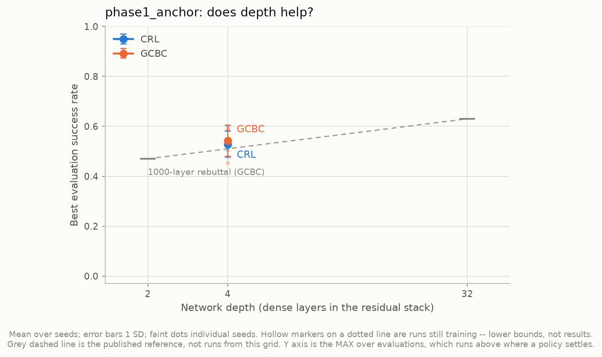
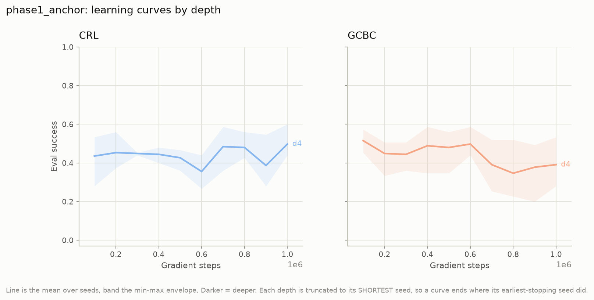
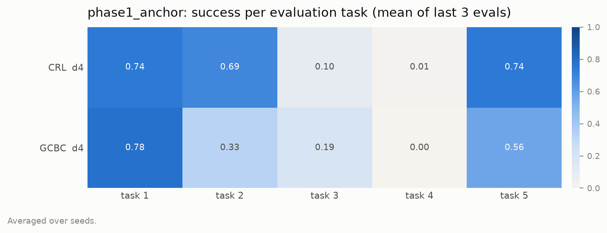

# phase1_anchor — the reproduction control

6 runs, finished. CRL and GCBC, **stock OGBench architecture, unmodified**, depth 4,
3 seeds each, on `antmaze-medium-stitch-v0`.

This grid is not an experiment. It is the control that tells us whether the harness is
right: if the published numbers do not come out of it, nothing measured in
[`../phase1_repro/`](../phase1_repro/) means anything, because the difference would be
in our plumbing rather than in the architecture.

**Full analysis — including whether the reproduction succeeded, the architecture
inversion it exposed, and the shared environment description — is §1, §3 and §5 of
[`../phase1_repro/README.md`](../phase1_repro/README.md).** That document covers both
grids; this folder holds the anchor's own figures so they sit beside the numbers they
produced.

| | value |
|---|---|
| tower | stock OGBench MLP, 3 × 512, GELU, LayerNorm after GELU |
| `repr_dim` (φ/ψ head) | 512 |
| step cap | 1,000,000 |
| runs | 2 agents × 3 seeds = 6 |

`fig1_success_vs_depth.csv`, max over evaluations (15 episodes/task × 5 tasks):

| agent | n | mean | SD | seeds |
|---|---|---|---|---|
| CRL | 3 | 0.529 | 0.051 | 0.600, 0.507, 0.480 |
| GCBC | 3 | 0.542 | 0.063 | 0.587, 0.587, 0.453 |

`fig1b_last3_vs_depth.csv`, last-3 mean pinned to 1,000,000 steps:

| agent | n | mean | SD | seeds |
|---|---|---|---|---|
| CRL | 3 | 0.455 | 0.081 | 0.569, 0.409, 0.387 |
| GCBC | 3 | 0.372 | 0.114 | 0.236, 0.516, 0.364 |

`reeval_50ep.json` in this folder is the same 6 runs rescored at OGBench's published 50
episodes/task — the only numbers comparable to their table.

## Figures

All regenerate with `python src/scripts/plot_results.py --grid phase1_anchor`, which
also publishes them here. The depth-axis figures each hold a single point by
construction, since this grid has one depth.

| file | what it answers |
|---|---|
| `fig1_success_vs_depth` | max-over-evaluations, one point per agent |
| `fig1b_last3_vs_depth` | the published metric, pinned to a common step |
| `fig2_learning_curves` | success vs gradient steps, by agent |
| `fig3_critic_diagnostics` | critic train/validation behaviour |
| `fig4_cost` | params, throughput, wall clock |
| `fig6_per_task` | the 5 tasks × 2 configs heatmap |

